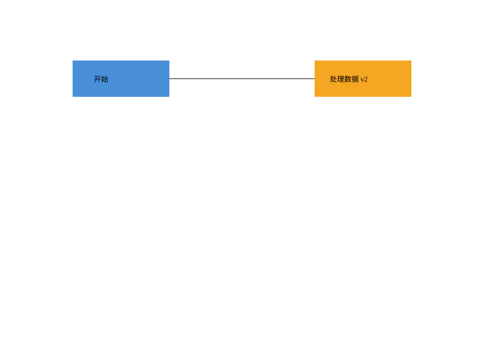

# CLI SVG Editor

软件设计课程的 TypeScript 面向对象 SVG 命令行编辑器。课程 Phase 1 的全部功能、测试及文档已完成，按阶段提交推送；最终交付版本以 [final 标签](https://github.com/Scoyn-X/CLI_SVG_EDITOR/tree/final)为准。

仓库：[Scoyn-X/CLI_SVG_EDITOR](https://github.com/Scoyn-X/CLI_SVG_EDITOR)。交付记录见 [doc/delivery.md](doc/delivery.md)。

为支持独立扩展，Phase 2 增加四类 CLI 扩展契约和统一加载器，提供 stats 图形统计与 dir 工作目录查询，并支持代码和配置两种装配方式。另提供 VS Code SVG 文件标记与原生 Outline 扩展。设计和运行说明见 [CLI 插件框架](doc/phase2-cli.md)及[VS Code 扩展](doc/phase2-vscode.md)。

## 运行

需要 Node.js >=24.11.0 <25 和 npm 11：

```sh
npm ci
npm run check
npm run cli
```

构建后可选择启用命令插件：

```sh
node dist/bootstrap/main.js --code-plugins
node dist/bootstrap/main.js --config plugins.config.json
```

例如输入：

```text
init 800 600
create g node
create rect box 120 100 160 60 #4a90d9 in node
create text label 155 135 "开始" in node
tree
move node 0 100
undo
save demo.svg
```

保存后浏览器可直接打开 SVG；EOF 正常退出。所有图形按唯一、大小写敏感 id 定位。

## 功能与边界

- 六种图形：rect、circle、ellipse、line、text、g；create 均支持 in 容器。
- 文档：init/read/save/canvas；图形：create/delete/move/scale/set/group/ungroup/addto/front/back。
- 查询：tree/show/help；历史：undo/redo。19 个命令全部实现。
- 每条编辑一个撤销单元，失败不改变文档/路径/历史；成功文档命令建立历史屏障，后续新编辑解禁。
- 支持 SVG 嵌套与文本、样式存在性、受控 transform/字体/viewBox 保留；不支持内容明确拒绝。详细范围见 [SVG 与文件](doc/svg-io.md)。

CLI 默认提供六种内置图形；加载器支持追加图形、命令、属性处理和树标签。当前生产插件为 stats/dir，后续功能包括 box 与 modified-star/(box) 标签。SVG 采用受控子集，跨父重组的局部坐标和样式继承规则见 [决策记录](doc/decisions.md)。

## 验证与样例

2026-11-11 完整工程检查通过：24 个测试文件、426 项测试，依赖检查覆盖 112 模块和 351 条依赖。六组 Phase 1 会话比较原始输出、退出码和四份 SVG 字节；真实进程测试验证 stats/dir 的 A/B 装配一致性。VS Code 扩展的 4 项自动测试通过。Phase 1 的历史修复记录见 [增量记录](doc/iteration-notes.md)。

[流程图](doc/examples/flowchart.svg)、[典型会话导出图](doc/examples/demo.svg)、[嵌套变换](doc/examples/nested.svg) 是实际保存产物。[回放说明](doc/development.md) 包含 Windows 运行方法；[typical.cli](tests/fixtures/typical.cli)、[flowchart.cli](tests/fixtures/flowchart.cli) 为可重复脚本。



## 文档

- [工程工作指南](doc/phase2-work-guide.md)、[集中验收清单](doc/phase2-acceptance.md)、[源码指标](docs/metrics/README.md)。

- [正式课程文档](doc/README.md)：架构方案、过程记录、一致性自查、质量保证。
- [架构图源](doc/architecture.puml) / [渲染图](doc/architecture.svg)。
- [验收索引](doc/acceptance.md)、[测试计划](doc/testing.md)、[系统修复记录](doc/system-regression.md)、[审查后增量](doc/iteration-notes.md)。
- [阶段路线与提交记录](doc/roadmap.md)、[开发说明](doc/development.md)、[历史检查](doc/historical-checks.md)。
- [领域](doc/domain-model.md)、[命令与历史](doc/command-history.md)、[树编辑](doc/tree-editing.md)、[完整 CLI](doc/cli.md)。
- [协作规范](agent.md)、[课程原文](phase_cli_1.md)、[第一次设计讨论](think1.md)。

Phase 1 的固定交付快照为 final，包含源码、测试、课程文档、报告及 PDF。Phase 2 的最终交付标签为 p2。工程协作与提交约定见 [agent.md](agent.md)。
