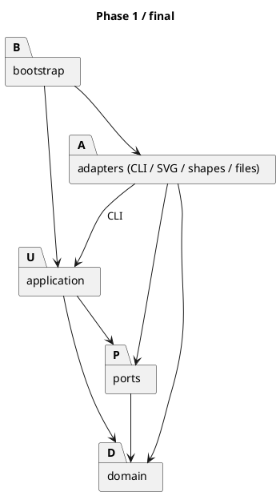
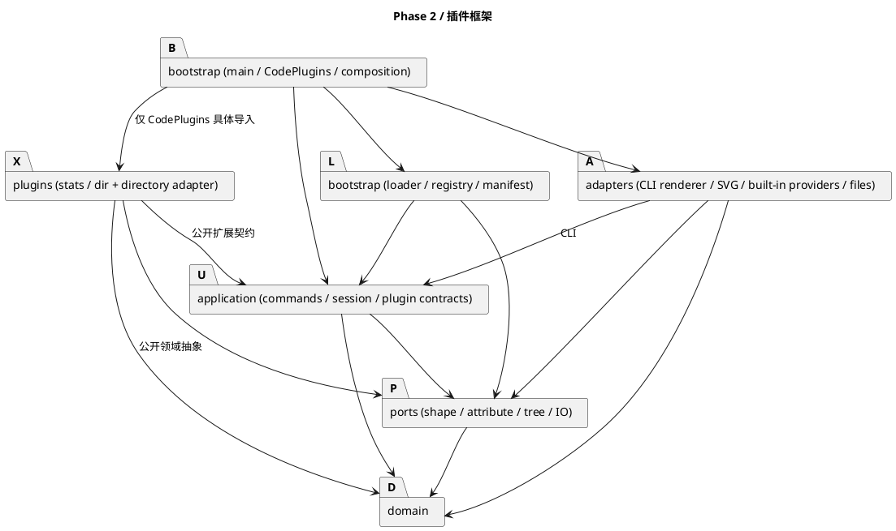
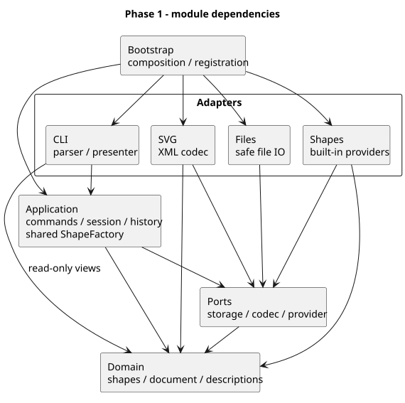

# CLI SVG Editor — 项目文档

本项目是软件设计课程的 SVG 命令行编辑器，使用 TypeScript 和面向对象设计，通过 REPL 完成文档读写、图形编辑、结构调整与撤销重做。课程 Phase 1 的六种内置图形和 19 个命令已实现，持续测试、独立系统验收及审查跟进均已完成。

本文件是课程要求的 `doc/README.md`，集中说明架构、AI 协作中的关键迭代、一致性自查和质量保证。以项目负责人视角展开的补充报告见 [Report.md](Report.md) 和 [Report.pdf](Report.pdf)。需求依据为 [phase_cli_1.md](../phase_cli_1.md)，未明确语义的工程选择见 [决策记录](decisions.md)。

文档更新：2026-11-26。Phase 1 冻结基线为 `final` / `ba7b418cb5554d6e2a3c8e1d66f9940fb3c40e3a`。下文的 Phase 1 过程、架构和历史结果保留当时口径，当前增量以本节 Phase 2 记录为准。

## Phase 2：插件式重构

### 从 Phase 1 到 Phase 2

Phase 1 的命令、图形与历史都写在内核里，新增一种图形或一条命令必须改工厂或分发表。Phase 2 把四处变化点抽成内核侧的稳定契约——图形类型、命令、树标签、属性语义——内核只依赖接口，实现放在独立插件包里；装配方式也收拢为一处注册路径，插件既能用代码装入，也能用配置装入。CLI 之外另有一个独立的 VS Code 扩展，用宿主提供的文件装饰与文档符号接口实现 SVG 标记和大纲。

这次重构没有改动 Phase 1 的命令语义：默认启动仍是六种图形与 19 条命令，`final` 的六组会话在字节级一致。变化集中在内核新增的契约与加载器、应用层的三个调用点，以及四个插件包。详细实现与取舍见 [CLI 插件框架](phase2-cli.md)；VS Code 部分见 [VS Code 扩展](phase2-vscode.md)。

### 扩展点清单

下表源码路径省略 `src/` 前缀。接口定义在内核侧，插件只依赖公开契约与公开领域抽象，依赖检查禁止内核反向导入插件。`PluginContext` 提供四种注册方法，`PluginModule` 描述激活协议。

| 接口与职责 | 内核调用位置 | 生产实现 | 禁用可选插件时 | 契约与失败处理 |
| --- | --- | --- | --- | --- |
| `ports/ShapeProvider`：图形创建、SVG 读回与帮助语法 | `application/ShapeFactory.create/fromSvg/getUsages`；`CreateCommand.apply` | 六个内置 Provider；`plugins/box/BoxProvider` | 六种内置类型仍注册，未知类型保留原错误 | 类型重名拒绝注册；provider 校验参数与子树；创建/导入成功后才发布；复合子类必须实现多态复制 |
| `application/Command` 抽象类与 `CommandRegistration`：命令执行、参数规则、帮助 | `CommandDispatcher.create` 查表；`adapters/cli/CliController.executeLine` 执行 | 19 条内置命令；`plugins/stats/StatsCommand`、`plugins/dir/DirCommand` | 插件命令不在 help 中，执行报 `error: unknown command: <name>` | 重名拒绝；参数错误报 `usage:`；普通异常转为单行错误，下一条命令仍可执行；编辑命令必须经过会话事务 |
| `ports/TreeDecorator`：逐树准备、逐行追加标签 | `adapters/cli/CliPresenter.tree` 先 `prepare`，再对标题与每行调用回调 | `plugins/box/BoxTypeLabel`、`plugins/modified-star/ModifiedStar` | 空列表，不附加标签，`tree` 字节不变 | 传入不可写的当前/干净描述；画布行 shape 为 undefined；空标签忽略；异常转为单行错误且不发布部分输出 |
| `ports/AttributeHandler`：属性匹配、受控修改与摘要 | `application/SetCommand.apply` 调用 `handles/apply/summarize` | `plugins/box/BoxAttributes` | 零命中，回退到原属性白名单 | 多命中报 `error: conflicting attribute handlers: <attr>`；处理失败不再回退默认规则，丢弃候选文档并保留历史 |

插件以类或类实例实现扩展点，并用自己的 `package.json` 的 `contributes` 声明提供哪些扩展；加载器在激活后按四类名称集合比对声明与实际注册。

### 两种装配方式

```powershell
node dist/bootstrap/main.js                 # 默认：仅 Phase 1 能力
node dist/bootstrap/main.js --code-plugins  # 方式 A：代码装配
node dist/bootstrap/main.js --config plugins.config.json  # 方式 B：配置装配
```

方式 A 的 `bootstrap/CodePlugins.ts` 是唯一具体插件装配文件；方式 B 由 `PluginLoader.loadConfig` 按配置顺序解析模块。两者都进入 `PluginLoader.activate → PluginRegistry.install`，共用暂存注册、冲突检查、清单校验与提交路径，因此装入同一插件集合时行为与输出完全一致。

```json
{
  "plugins": [
    { "module": "./dist/plugins/stats" },
    { "module": "./dist/plugins/dir", "enabled": true, "options": {} },
    { "module": "./dist/plugins/box" },
    { "module": "./dist/plugins/modified-star" }
  ]
}
```

每项只接受非空 `module`、布尔 `enabled` 和任意 JSON `options`；`enabled: false` 完全跳过；相对路径以配置文件目录为基准，包名按 Node 的 ESM 解析规则处理。配置结构非法时报 `error: invalid plugin config` 并以默认能力启动；模块缺失、无默认导出、清单不符、激活失败各有独立错误信息，均不终止主程序。

### 重构前后的模块依赖





加载器按配置字符串动态装入模块，没有具体插件的静态依赖；Node 内置依赖只出现在装配、IO 适配器与 `dir` 的 `NodeDirectoryReader`。VS Code 扩展是独立包，不进入 CLI 依赖图。

### 架构决策

- **P2-01 属性处理用候选文档与单次提交**：`AttributeHandler.apply` 只操作 `EditorSession.edit` 创建的候选文档，可以改多个子件；零命中回退白名单，多命中直接拒绝；apply/summarize 抛错则整体丢弃候选并保留 redo。一次 `set` 仍是一个 undo 单元。
- **P2-02 语义类型与 SVG 标签分离**：`Shape.getType()` 可以与 SVG 标签不同，provider 显式声明 `getSvgTag` 并只在标签匹配时消费 `data-kind`；未安装对应插件时 `<g data-kind="box">` 降级为普通组并保留子树。`box` 构造按子件 id/标签模式校验，缺件、类型错误或重复 id 拒绝整份读入。
- **P2-03 注册暂存、激活后校验清单**：每个插件先拿到独立的 `PluginContributions`，`activate` 结束后封闭上下文并按四类集合核对 `contributes`，全部成功才提交；失败插件不留下任何注册，已成功的插件不回滚。A/B 共用这条路径，代码装配不能绕过校验。
- **P2-04 干净基准与标签顺序**：`init` 与成功的 `read`/`save` 后保存不可变的干净描述，`tree` 每次把当前与干净描述交给各标签；`ModifiedStar` 按内容比较（新节点立即标记、变化向祖先与画布传播、`undo` 回保存点后清除），标签状态封装在实例字段，按注册顺序拼接，同一行输出 `(box) *`。

完整 ADR 正文、失败契约与序列化细节见 [CLI 插件框架](phase2-cli.md#adr)。

### `dir` 的目录访问适配器

| 适配器角色 | 接口/类 | 职责 |
| --- | --- | --- |
| Client | `plugins/dir/DirCommand` | 请求工作目录、读取、排序与输出，不直接使用 Node fs |
| Target | `plugins/dir/DirectoryReader` | `currentDirectory`/`read`，返回中立的名称与类型 |
| Adapter | `plugins/dir/NodeDirectoryReader` | 把 `process.cwd()` 与 `Dirent` 转换成 Target 的结果 |
| Adaptee | Node `process.cwd`、`fs.readdirSync` | 提供真实进程路径与文件系统信息 |

`DirPlugin` 接受可替换的 `DirectoryReader`，默认注入 `NodeDirectoryReader`；两种装配激活同一个插件实现，使用同一接口。测试替身覆盖读取失败与特殊项，真实 CLI 测试使用固定临时目录验证命令与适配器的组合。

### VS Code 扩展

扩展在 [`vscode-extension`](../vscode-extension/package.json) 下独立构建，提供两项能力：Explorer 中为 `.svg` 文件显示 `[]` 标记，以及在原生 Outline 中显示 SVG 元素的嵌套层级并在点击时定位源码。

`activate` 由宿主在启动后调用。扩展把 `SvgFileDecorationProvider` 与 `SvgDocumentSymbolProvider` 注册给 VS Code，并把注册句柄交给扩展上下文释放。Explorer 需要呈现资源时向文件装饰提供者查询，Outline 需要结构时按 `.svg` 选择器调用符号提供者；宿主负责渲染、文档更新与跳转，扩展只返回 `FileDecoration`、层级 `DocumentSymbol` 和源码区间。

文件标记体现 Decorator 的思路：资源本身不变，Explorer 获得额外显示信息；与经典 Decorator 的区别在于 VS Code 通过提供者接口查询元数据、由宿主完成组合和渲染。Adapter 方面，Explorer 期望的目标契约是 `FileDecorationProvider`，实现把 URI 后缀与 `workspace.fs.stat` 的结果转成 `FileDecoration`；符号提供者同样适配一层，把解析节点与 UTF-16 区间转成宿主的 `DocumentSymbol`、`range` 和 `selectionRange`。

Phase 1 的解析与模型没有被直接复用：`XmlSvgCodec` 为 CLI 领域文档服务，不暴露源码区间且会补全 id、校验受支持图形；Outline 需要保留无 id 节点、遍历任意 SVG 元素并随未保存文本更新。扩展因此使用独立的 SAX 解析层和带区间的 `SvgOutlineNode`，再经宿主适配器映射。复用面在领域之外：示例 SVG、有序树与容器遍历的思路。

### Phase 2 验证入口

| 内容 | 入口 |
| --- | --- |
| 四扩展点、装配、加载失败与回滚 | [CLI 插件框架](phase2-cli.md) |
| `stats`、`dir` 与目录适配器 | [CLI 插件框架](phase2-cli.md#statsdir-与适配器) |
| VS Code 的宿主机制、模式分析与复用 | [VS Code 扩展](phase2-vscode.md) |
| 操作步骤、预期结果与截图 | [集中验收清单](phase2-acceptance.md) |
| 源码指标与统计口径 | [指标口径](../docs/metrics/README.md)、[当前报告](../docs/metrics/phase2-current.md) |

当前检查：26 个测试文件、453 项测试通过，依赖检查覆盖 121 个模块与 381 条依赖、零违规；Phase 1 六组会话与双装配回放逐字节一致；VS Code 扩展 4 项自动测试通过。Phase 1 的行为以 `final` 为固定对照，Phase 2 的交付标签为 `p2`。

## 目录

- [Phase 2：插件式重构](#phase-2插件式重构)
- [项目概况与运行](#项目概况与运行)
- [架构方案](#架构方案)
- [过程记录](#过程记录)
- [一致性自查](#一致性自查)
- [质量保证手段](#质量保证手段)
- [交付与文档索引](#交付与文档索引)

## 项目概况与运行

### 环境与启动

需要 Node.js `>=24.11.0 <25`、npm `>=11 <12`。在仓库根目录执行：

```sh
npm ci
npm run check
npm run cli
```

项目使用 TypeScript strict、Vitest、ESLint 和 dependency-cruiser；SVG 解析使用 `@rgrove/parse-xml`。具体版本由 `package-lock.json` 固定。`npm run check` 依次执行类型检查、lint、构建、依赖检查、测试和编译后运行时组装检查。

进入 `svg>` 提示符后，可输入以下命令：

```text
init 800 600
create g node
create rect start 120 100 160 60 #4a90d9 in node
create text label 155 135 "开始" in node
tree
move node 0 100
undo
redo
save demo.svg
```

保存的 SVG 可直接在浏览器中打开；输入结束符 EOF 退出。逐行脚本回放及 Windows 使用说明见 [development.md](development.md)。

### 功能范围

| 类别 | 已实现内容 |
| --- | --- |
| 图形 | `rect`、`circle`、`ellipse`、`line`、`text`、`g`；所有类型的 `create` 均支持尾缀 `in <containerId>` |
| 文档命令（4 个） | `init`、`read`、`save`、`canvas` |
| 编辑命令（10 个） | `create`、`delete`、`move`、`scale`、`set`、`group`、`ungroup`、`addto`、`front`、`back` |
| 显示命令（3 个） | `tree`、`show`、`help` |
| 历史命令（2 个） | `undo`、`redo` |

图形通过唯一、大小写敏感的 id 定位。每条成功编辑构成一个撤销单元，失败不改变文档、路径、id 分配或历史。`tree/show/help` 和无参数 `canvas` 不进入历史；成功的文档操作建立历史屏障，下一条成功编辑解禁。细则见 [命令与历史](command-history.md)。

以上为 Phase 1 功能基线。Phase 2 当前已提供插件加载和独立 VS Code 扩展，生产 box 和两类树标签已接入。SVG 读入继续采用明确的受支持子集；不支持的元素或属性报错，避免静默丢失数据。具体范围见 [svg-io.md](svg-io.md)。

## 架构方案

### 模块划分与依赖方向

生产代码分为八个模块。领域对象维护自身规则，应用层组织用例，外部输入输出通过端口和适配器连接；入口只负责注册和组装。

| 模块 | 职责 | 允许依赖及理由 |
| --- | --- | --- |
| `src/domain` | `Shape/LeafShape`、六类图形、`SvgDocument/ShapeTree`、几何与属性校验、描述与复制、树不变量 | 仅自身；领域规则独立于终端、文件和 XML |
| `src/application` | 19 个命令、`EditorSession`、历史与快照、命令分发、共享图形工厂、结果协议 | `domain`、`ports`、自身；通过协议访问外部能力 |
| `src/ports` | 存储、SVG 编解码、图形创建与导入接口，以及中立导入数据 | `domain`、自身；不绑定 Node 或 XML 库 |
| `src/adapters/cli` | 分词、控制器、REPL、提示符、错误与树形输出 | `application`、`domain`、自身及 Node 终端能力；消费用例和只读描述 |
| `src/adapters/svg` | 严格 XML/命名空间校验、候选补 id、通用序列化 | `ports`、`domain`、自身及 XML 库；不依赖应用层或另建类型表 |
| `src/adapters/files` | 路径解析、UTF-8 读写、安全临时文件替换 | `ports`、自身及 Node 文件/路径能力；不决定历史规则 |
| `src/adapters/shapes` | 六类 Provider 的参数、帮助语法和 SVG 构造 | `ports`、`domain`、自身；不持有全局会话 |
| `src/bootstrap` | `EditorComposition` 注册与注入、运行环境及入口 | 各生产模块及 Node；集中组装，不实现图形算法 |

以下为已渲染的 PlantUML 组件图，箭头表示允许的模块依赖；[图源](report-architecture.puml) 与 [横向版本](architecture.puml) 描述相同的八模块及依赖关系。



依赖规则同时写入 [dependency-cruiser.config.json](../dependency-cruiser.config.json)，检查循环、未解析 import、越界依赖及生产代码导入测试/开发工具，类型导入也受约束。领域层不得依赖应用层或适配器，应用层不得依赖具体适配器。

测试按 domain/application/adapters/integration/e2e/architecture/bootstrap 分层，fixtures 提供可重复输入；`doc` 保存文档、图源和示例。`node_modules/dist/artifacts/coverage` 是忽略产物，不作为课程源码提交。

### 设计模式与实际落点

| 模式 | 实现落点与作用 | 取舍 |
| --- | --- | --- |
| Command | `Command/EditCommand` 与具体命令；编辑统一经过 `EditorSession.edit` | 一条编辑对应一个历史单元，复杂树操作也只需一次撤销 |
| Composite | `Shape/Group` 统一几何与属性操作，文档统一受控删除；容器多态准备子孙变换 | 不按类型名判断叶子/容器；组样式设置自身，保留 SVG 继承 |
| Memento | `DocumentMemento/HistoryEntry` 保存独立的编辑前后领域副本 | 单次完整复制 O(N)，H 条历史占用 O(H×N)；优先保证精确恢复 |
| 工厂与提供者 | 同一 `ShapeFactory` 为 CLI 创建和 SVG 导入查找 Provider | 各提供者负责自身构造与校验，避免重复标签映射 |
| Adapter 与依赖倒置 | 文件/XML/CLI 适配器实现或消费内层协议；显示通过多态描述输出 | 外部技术变化不传入领域对象，显示无需比较图形类型名 |

按课程要求，两处按名字分派明确标记为**待重构**：`CommandDispatcher` 的命令名到实现、`ShapeFactory` 的类型名到 Provider。当前使用集中注册；后续插件阶段再考虑注册来源与生命周期。复制、SVG 输出、`tree/show` 和几何运算不另建名字分派。

### 状态、原子性与历史

`SvgDocument` 通过私有 `ShapeTree` 管理有序节点及全局 id/父级索引，维护单父级、无环、id 唯一和顺序一致性。结构变化经过受控操作，外部不能直接修改子列表。`Group` 的几何变换先准备全部子孙结果，全部通过后再应用，避免后部节点溢出造成部分修改。

编辑先复制当前文档，在候选上执行命令和准备反馈；成功后再准备独立发布副本、前后快照，最后发布并记录一条历史。失败不暴露候选变化。`undo/redo` 恢复独立快照，`redo` 不重跑命令、不重新调用工厂或访问文件；撤销不靠逆运算消除浮点误差。

`read` 在会话锁内完成路径解析、读入、XML 校验和补 id，成功后一起发布文档、路径、警告及历史屏障。`save` 在同目录独占创建临时文件，完成写入、flush、关闭和 rename 后才更新会话；失败不预先删除旧文件。`init` 清除读入路径，显式另存不改变读入路径。

成功的 `init/read/save` 和修改尺寸的 `canvas` 清空旧历史并禁止撤销重做，下一次成功编辑解禁；查询不改变历史。描述和值对象保持只读，历史使用领域复制，不将 XML 或类实例的 JSON 转换作为快照。

### 变化点与设计边界

| 可能变化 | 当前设计与暂不实现的部分 |
| --- | --- |
| 新图形与复合图形 | 共享 Provider/Factory，区分可容纳与可解散能力；`data-kind` 可保留，但读回普通 `g` 不恢复插件能力。测试探针只验证扩展边界，不注册生产 `box` |
| 新命令或其他入口 | 应用命令与会话可复用，CLI 语法/显示隔离；当前编辑摘要是英语字符串，多语言需要更中立的反馈协议 |
| XML 或存储实现 | `SvgCodec/DocumentStorage` 可替换；同步 IO 满足当前 REPL，未来异步化须维持串行发布 |
| 大文档与历史成本 | 快照已封装，但仍直接构造具体 Memento；未根据性能证据引入增量快照、历史裁剪或事件溯源 |
| 更广 SVG 支持 | 受控保留 translate/scale、字体及画布元数据；不承诺完整 CSS、路径、字体排版或重组后的世界坐标补偿 |

未明确的语义作为可修订工程假设记录：跨父级 `group` 使用共同父级、原前序与最早分支位置（D03）；无变化的成功编辑仍入历史（D05）；默认保存路径生命周期（D06）；单尺寸参数（D07）。重组可能改变变换或样式继承后的视觉，目前不做补偿。

未 `init/read` 时 `help` 仍按 §4.2 的前置条件拒绝执行，但与启动横幅提示存在体验上的矛盾，列入 D10 待确认。上述选择不表述为已经获得课程方确认。

## 过程记录

开发采用“先分析需求与设计、分步实现、持续验证、独立系统回归”的流程。AI 辅助研究、生成代码和测试、分析失败及整理记录；项目负责人负责范围、架构取舍、验证要求和审查意见筛选。AI 输出和审查结论都需要与需求、实现及实际证据对照。

以下选取对架构或验证方法有影响的迭代，完整阶段记录见 [roadmap.md](roadmap.md)，逐次改动见 [iteration-notes.md](iteration-notes.md)。

| 关键问题 | 判断与修改 | 形成的依据 |
| --- | --- | --- |
| 如何借鉴已有编辑器 | 参考 SVG-Edit 的编辑内核/UI 分离、Fabric.js 的类型注册和 tldraw 的历史单元；根据课程约束选择共享工厂与多态，而非直接引入框架 | 未复制上述项目代码或将其作为依赖；CLI、导入和显示避免重复类型分派 |
| 最初计划缺少独立测试环节 | 项目负责人复核计划后补充“持续测试 + 独立系统验收”，将交付置于回归之后 | 建立 A01—A30 需求索引和 S01—S08 关键场景，测试不集中拖到最后 |
| 递归修改可能破坏原子性 | 后出现的子孙溢出会留下前部修改；命令保留候选引用也可能绕过会话封装 | 几何采用准备/应用两阶段，发布额外复制，测试溢出、引用隔离及失败保留 redo |
| 外部 SVG 不能静默简化 | 背景示例含变换、字体和 viewBox；读入后丢弃元数据会改变图像 | 明确支持子集，受控保留元数据并拒绝未知内容；XML 库兼容性问题通过替换实现解决，未放宽 strict 检查 |
| 系统测试发现边界缺陷 | XML Name 校验不足以覆盖非法 QName；路径解析回调位于 read 锁外 | 修复并保留回归用例，验证失败不改变文档、路径、历史或补 id 状态 |
| 扩展测试通过不等于数据保持 | 审查探针只证明提供者被调用，实际构造了默认子树，未证明导入真实输入 | 改用区别于默认模板的 id、顺序、属性与文本，验证嵌套、空子树、往返降级及失败状态 |
| 审查结论也需要核验 | 历史分支停留旧提交被误判为整改未推送 | 核对真实远程默认/整改分支 SHA，补勘误并保留原报告，避免改写历史证据 |
| 最后显示层修复应限制范围 | 修正 `tree` 同级列对齐及单目标 `group` 的 `1 child`，保留显式 stroke 和 XML 属性顺序 | 先复现旧输出，再补精确显示及 undo/redo 断言；八套回放仅有预期差异，四份 SVG 字节不变 |

多轮审查促进了代码与测试修订，但开发侧自动复核不等同于第三方独立审查。旧报告保留其当时基线和测试数量，勘误及增量另行记录，避免把计划、历史结果或方法调用次数写成当前功能正确性的证明。

## 一致性自查

| 检查项 | 实际结果与依据 |
| --- | --- |
| 模块与目录 | 八模块均有实际实现，与上述方案一致；85 个生产源码文件，77 个同名类、7 个接口及 main 入口。历史管理在应用层，IO 在适配器，新增描述/协议已同步入文档 |
| 依赖方向 | 最近完整检查覆盖 91 模块、288 条依赖，0 违规；包含 XML 库模块，类型导入同样受检 |
| 依赖抽查 | `EditorSession/ReadCommand/SaveCommand` 使用 ports/domain；`XmlSvgCodec` 使用 ports/domain/XML 库；`NodeDocumentStorage` 使用 ports/Node；`CliPresenter` 使用 application/domain；Provider 使用 ports/domain |
| 命名分派与模式 | 名字查找集中于 `CommandDispatcher.commands.get` 和 `ShapeFactory.providers.get`；bootstrap 负责注册，复制/显示/序列化使用多态 |
| 代码规范 | `SourceConventionChecker` 检查一类一文件、封装、顶层函数和明显类型分派，并用正负例验证扫描器；结合源码抽查判断设计，不声称静态扫描证明全部语义正确 |

图源与渲染图已生成并检查，本文纵向图与原横向图的依赖关系一致。需求原文与首次讨论保持原样；后续修订通过决策和增量记录追踪。完整规则与检查方法见 [testing.md](testing.md)。

## 质量保证手段

### 功能完整性与回归

功能验收以 [acceptance.md](acceptance.md) 的 A01—A29 和 S01—S08 映射为基础，覆盖六种图形、19 个命令、规定错误与典型流程；A30 单独追踪 Git 和标签交付。重点验证以下可观察行为：

- 几何与属性白名单、样式缺省和继承、嵌套容器及有序树不变量。
- 删除、分组、归属调整与 z-order 的单条撤销单元，恢复原父级、顺序、属性和 id 索引。
- 失败保留 redo，新成功编辑清空 redo，文档屏障与查询不入历史。
- 补 id 避开全文档已有 id；读入失败不泄漏警告或消耗分配状态。
- XML 命名空间、转义、特殊文本、受支持元数据、读写往返及真实文件失败。
- CLI 引号、空文本、颜色中的 `#`、`in` 子句、错误行、树列对齐和历史摘要。

往返测试比较结构与属性语义，包括属性是否存在；撤销测试比较原值与结构。真实 CLI 测试独立编译当前源码，避免误用旧构建产物。

### 已执行验证与限制

以下保留 `04cc97e` 的 Phase 1 历史检查；最新 Phase 2 结果见本文开头及集中验收清单。

| 检查 | 结果 |
| --- | --- |
| TypeScript strict、ESLint、生产构建 | 通过，lint 零警告 |
| 依赖方向 | 91 模块 / 288 条依赖 / 0 违规 |
| 自动测试 | 21 个文件 / 415 项通过 |
| 编译后运行时组装 | 通过 |
| 显示修复后的真实 CLI 回放 | 八套与修复前对比，仅有预期对齐和单复数变化 |
| 保存产物对比 | 四份 SVG 与修复前逐字节一致 |

最新测试说明及审查增量见 [testing.md](testing.md)、[iteration-notes.md](iteration-notes.md)。首次系统交付的 [test-report.md](test-report.md) 保留当时的 376 项结果及浏览器观察，属于历史报告，不代表当前测试总数。

浏览器检查覆盖实际生成的 [流程图](examples/flowchart.svg)、[典型会话](examples/demo.svg)、[嵌套变换](examples/nested.svg) 及架构图；图像检查只支持这些样例的展示结论，不能替代历史和错误分支测试。未设置虚构覆盖率，未配置 CI，也未声称跨平台或大图性能已经验证。

当前保留边界包括受控 SVG 子集、快照内存成本、重组后的局部坐标/继承语义，以及 D10 的 `help` 前置条件。树列宽按 JavaScript 字符串长度计算，不额外处理所有 Unicode 终端显示宽度；示例文字排版不承诺与每一处 transcript 逐字相同。

## 交付与文档索引

代码、测试和文档通过分步 Git 提交保留真实开发过程。两个交付标签：`final` 对应 Phase 1 的完整交付（`ba7b418`），`p2` 对应 Phase 2 的交付提交；标签创建后不再移动，后续分支提交不会自动改变已发布的标签。

| 文档 | 用途 |
| --- | --- |
| [Report.md](Report.md) / [Report.pdf](Report.pdf) | 补充课程报告，采用项目负责人视角叙述架构思考和关键迭代 |
| [phase2-cli.md](phase2-cli.md) / [phase2-vscode.md](phase2-vscode.md) | Phase 2 的扩展点、装配、加载失败契约与 VS Code 实现细节 |
| [phase2-acceptance.md](phase2-acceptance.md) / [evidence/phase2/](evidence/phase2/README.md) | Phase 2 的集中验收步骤、执行记录与原始证据 |
| [development.md](development.md) / [cli.md](cli.md) | 环境、运行、脚本回放及命令交互 |
| [domain-model.md](domain-model.md) / [command-history.md](command-history.md) / [tree-editing.md](tree-editing.md) / [svg-io.md](svg-io.md) | 各部分设计与实现细节 |
| [decisions.md](decisions.md) / [iteration-notes.md](iteration-notes.md) | 工程假设、修改原因及逐次增量 |
| [testing.md](testing.md) / [acceptance.md](acceptance.md) | 测试安排、需求映射和关键验收场景 |
| [roadmap.md](roadmap.md) / [historical-checks.md](historical-checks.md) / [delivery.md](delivery.md) | 工程里程碑、历史验证及交付记录 |

GitHub 仓库：[Scoyn-X/CLI_SVG_EDITOR](https://github.com/Scoyn-X/CLI_SVG_EDITOR)。交付快照：[final](https://github.com/Scoyn-X/CLI_SVG_EDITOR/tree/final)、`p2`。

生产插件的独立提交、零内核差异、版本 B 和单/双标签回放见 [Phase 2 交付证据](evidence/phase2/README.md)。

第 005 轮审核整改的逐项处理、语义决策和验证结果见 [整改记录](phase2-review-fixes.md)。
