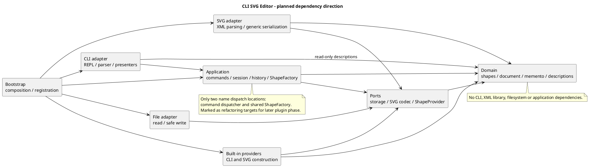

# 软件设计课程项目文档

版本：v0.4，2026-10-11；文档基线已提交推送，工程基础初始化及工具检查已完成，用户已确认本轮 35 文件清单并授权本地提交。

本文件是课程要求的主文档。架构内容描述拟实现方案；过程记录只记实际发生的讨论；一致性与质量栏目如实区分设计检查和实现检查。当前没有业务代码，不能把设计方案描述成已验证实现。

需求来源：[phase_cli_1.md](../phase_cli_1.md)。协作权限：[agent.md](../agent.md)。具体语义与验收分别见 [decisions.md](decisions.md) 和 [acceptance.md](acceptance.md)。

## 架构方案

### 1. 模块划分与职责

工程根目录是 `pj1/CLI_SVG_EDITOR`，不是整个课程目录 `SD`。本轮复用该目录下用户已有的空 Git 仓库，避免把其他课程项目纳入同一仓库。

以下模块目录已建立；业务内容仍是规划，当前源码仅包含 bootstrap 的环境检查和最小入口：

```text
src/
  domain/             # 图形、文档、树结构与值对象
  application/        # 会话、用例、Command、历史、共享图形工厂
  ports/              # 由内层使用的外部能力接口
  adapters/
    cli/              # REPL、分词、命令语法、展示
    svg/              # XML 与领域对象的转换
    files/            # 文件 IO
    shapes/           # 六种内置图形的提供者
  bootstrap/          # 具体对象组装与注册
tests/
  domain/
  application/
  adapters/
  integration/
  e2e/                # 真实 CLI 进程端到端测试
  architecture/       # 架构约束检查（或使用工具配置）
  bootstrap/          # 启动环境边界检查
  fixtures/           # 可提交的 SVG 和命令样例
doc/
  README.md           # 本文
  architecture.puml
  decisions.md
  acceptance.md
  testing.md
  roadmap.md
  development.md      # 实际工具链与工程检查入口
```

| 模块 | 拟承担职责 | 明确不承担的职责 |
| --- | --- | --- |
| domain | `Shape` 抽象、五种叶子图形、`Group`、`SvgDocument`；校验属性及几何，维护树与 id 索引；多态复制和只读描述 | 不读文件、不打印、不认识 XML 库和 CLI token |
| application | `EditorSession`、具体编辑命令、文档用例、`HistoryManager`、`CommandDispatcher`、`ShapeFactory`；组织执行和状态提交 | 不直接使用终端或文件系统，不以图形类型分支实现几何操作 |
| ports | `DocumentStorage`、`SvgCodec`、`ShapeProvider`、工厂访问接口等必要协议 | 不包含 Node 文件操作或具体图形提供者注册 |
| adapters/cli | REPL、带引号信息的 token、命令语法、参数 schema 转换、错误/结果输出、tree/show/help | 不修改图形字段，不维护自己的历史 |
| adapters/svg | XML 解析、候选文档构建、通用 XML 序列化、导入警告收集 | 不自行建立标签到类的第三套映射 |
| adapters/files | 读取、临时文件与替换保存、路径错误映射 | 不决定 undo 是否允许 |
| adapters/shapes | `RectProvider` 等内置提供者；创建参数 schema、从参数/中立 SVG 描述构造领域对象 | 不保存全局文档，不含独立类型名分派 |
| bootstrap | 实例化依赖、注册六种提供者、注册命令、启动 CLI | 不承载图形算法或业务规则 |

一类一文件，类名与文件名一致。上表中的名字是设计落点，不表示这些类已经存在。接口和值对象的数量以实际职责为准，不为每个类机械创建接口。

组件图箭头表示静态代码依赖。以下代码块与 [独立图源](architecture.puml) 保持一致；本轮未运行 PlantUML 渲染器。



### 2. 设计模式的选择及拟落地方式

| 模式/原则 | 拟落地位置 | 解决的问题及取舍 |
| --- | --- | --- |
| Command（必需） | `CreateCommand`、`MoveCommand`、`GroupCommand` 等对象，经执行入口和历史管理器运行 | 一条编辑意图一个撤销单元；CLI、未来 GUI 可调用相同应用能力 |
| Composite（需求语义） | `Shape` 和容器能力；`Group` 的有序子树 | 命令统一对待容器和叶子，容器递归 move/scale，删除统一处理整棵子树 |
| Memento（当前选择） | 文档快照与历史条目 | 精确恢复坐标、样式缺省、父级及位置；第一阶段接受完整文档复制的空间成本 |
| 工厂与提供者 | 共享 `ShapeFactory` + `ShapeProvider` | CLI 与 SVG 读回复用类型创建；为后续复合类型留下位置 |
| Adapter / 依赖倒置 | 终端、SVG 和文件适配器实现内层协议 | 隔离 IO 和第三方库，允许替换入口与 XML 实现 |

不为展示或遍历再引入按类型名分派的 Visitor。图形以多态方法产生中立的只读描述：元素标签、明确设置的属性、文本、子节点，以及用于展示的语义属性分组。通用 SVG 序列化器据描述输出 XML；CLI presenter 据描述生成格式。描述不带终端树线或完整 XML 字符串，领域对象仍封装行为，而非退化成公共数据袋。

类型创建的两条路径：CLI 的 `create` 获取 schema 并交给同一工厂；SVG reader 交出不依赖 XML 库的元素视图，由同一工厂选择提供者。提供者承担本类型的创建与校验。`ShapeProvider` 不依赖 CLI token 或 XML DOM 类型。

**两处待重构点：** `CommandDispatcher` 的命令名注册/分发与 `ShapeFactory` 的类型名注册/分发，按需求 §2.1 明确标记为待重构。阶段一采用集中注册的简单实现；后续插件阶段调整注册来源和生命周期，不把类型判断散落到 parser、serializer、tree 或 clone。

### 3. 核心对象、结构及执行流程

`SvgDocument` 拥有画布、根级列表及 id 索引，提供受控的结构操作。根画布不是普通 `g`，没有可被编辑命令定位的图形 id。子列表不暴露可写引用；每个附着节点只有一个父级，图形树无环，索引与整棵树一致。

结构插入、移除和重组前完整校验 id、父级及祖先关系。索引管理可由私有协作对象承担；文档不承担路径、文件 IO、历史或输出，防止形成上帝类。

`EditorSession` 维护当前文档与默认保存路径；`HistoryManager` 管理历史与屏障；文件和 SVG 能力通过 ports 注入。历史对象不能混入领域快照。

编辑流程：

1. CLI 完成分词和语法校验，保留引号信息；通用参数转换不包含类型专用分支。
2. 应用入口校验文档状态，工厂/领域对象校验创建、几何、属性和结构约束。
3. 以当前文档的多态深复制建立候选状态，在候选状态执行 Command。
4. 执行成功后发布候选文档，并生成一个历史条目；失败丢弃候选状态，不改路径、历史或 id 分配。
5. 输出结构化结果经 CLI presenter 生成题目约定的反馈。成功的查询不进入历史。

快照深复制保留具体子类型、属性“未设置”状态和有序结构；父级及索引指向新对象。undo/redo 发布独立的恢复副本，历史快照不得共享可写节点。重做恢复已保存的后状态，不重新读文件或重新分配 id；后续入口只以 id 寻址，不缓存跨恢复的可写图形引用。

预计每次编辑复制成本为 O(N)，历史空间为 O(H × N)，其中 N 是图形数、H 是历史条目数。本阶段没有自动裁剪历史的需求，不擅自增加可能丢失撤销能力的数量上限。

`read` 先完成读文件、解析、补 id 和校验，再一次替换会话并建立屏障，警告也在成功后输出。`save` 完成序列化和文件替换后才改变路径/历史状态。外部 IO 失败与领域失败统一由应用边界转换为规定错误。

### 4. 依赖方向规则

| 使用方 | 允许依赖 | 理由 |
| --- | --- | --- |
| domain | domain 内部及语言标准能力 | 领域规则可独立验证，不绑定基础设施 |
| ports | domain 的公开抽象与中立值对象 | IO 协议可以接收文档或工厂能力，不引入适配器类型 |
| application | domain、ports、application 内部 | 应用组织业务，通过接口访问外部能力 |
| adapters/cli | application、必要的 domain 只读描述 | 获取用例与展示数据；不能越过应用直接编辑文档 |
| adapters/svg、adapters/shapes | ports、domain、各自模块内部 | 实现协议；SVG reader 使用注入的工厂接口，不依赖工厂具体类 |
| adapters/files | ports、运行平台的文件能力 | 封装 IO |
| bootstrap | 上述模块的公开入口 | 唯一集中组装具体实现的地方 |
| tests | 被测模块及其测试协作对象 | 测试不能成为生产代码依赖 |

禁止：domain → application/ports/adapters；application → adapters/bootstrap；ports → application 的具体类；适配器横向互相导入具体类；生产代码 → tests；循环依赖。第三方 XML 库只出现在 SVG 适配器，终端与文件平台能力只出现在对应适配器和启动入口。

阶段 2 使用 TypeScript strict、ESLint 和 dependency-cruiser 检查实际依赖，包括类型 import。规则和工程测试已配置，详见 [开发说明](development.md)；工具不能代替模式及封装审查。违反依赖规则时登记待处理项并修正，不能仅通过修改架构图掩盖无理由的越界。

### 5. 变化点假设

| 变化点 | 当前预留 | 当前不实现与原因 |
| --- | --- | --- |
| GUI / 智能体入口 | 结构化应用调用、id 寻址、CLI 输出隔离 | 不引入 GUI/HTTP 框架，当前没有该入口需求 |
| box 及新图形类型 | 提供者、容器能力、多态描述/复制、共享工厂 | 不注册 box，不建立插件加载器；课程阶段边界明确 |
| 插件读回/降级 | 同一工厂可处理类型及中立扩展标记，普通 g 可保留 data-kind | 不实现插件生命周期；未来复合类型不能要求修改现有编辑命令 |
| SVG 支持范围扩大 | 编解码协议、显式导入范围、失败原子性 | 不承诺全 SVG/CSS/路径支持；复杂变换需要独立决策 |
| 撤销性能 | Command 意图与历史快照分离 | 不做增量快照/事件溯源，先验证精确恢复 |
| 存储能力 | storage 接口 | 不实现云端存储、数据库或自动保存 |
| 显示格式 | 通用只读描述与 presenter | 不让 domain 返回终端文本，不引入通用 UI 框架 |

未来 `box` 的设计推演：提供者构造一棵受其约束的子树，box 自身实现属性传播、多态复制和描述，并能表明“允许容纳子节点但不允许 ungroup”。容器资格不靠命令比较类型名判断。`data-kind` 的识别与降级走现有工厂，序列化走中立描述。此处是设计验证，当前没有实现 box 或其错误分支。

### 6. 需求决策

[decisions.md](decisions.md) 逐项区分：题目明文、工程暂定规则、待教师/用户确认。跨父级 group、历史生命周期等已形成可修改的工程基线；transform/viewBox 和扩展导入范围仍开放，不在这里冒充已获确认。

## 过程记录

| 日期/阶段 | 实际讨论或发现 | 修订与依据 |
| --- | --- | --- |
| 2026-10-11 / 初次阅读 | 用户要求仅分析；提出领域、应用、适配器边界及 Command + Memento | 原讨论见 think1.md，未编写业务代码 |
| 2026-10-11 / 参考研究 | 查阅 SVG-Edit、Fabric.js、tldraw 官方说明；发现创建工厂不足以覆盖读回与展示 | 统一 CLI 与 SVG 创建入口，复制和输出通过多态，防止第三处分派 |
| 2026-10-11 / 需求复核 | 默认样式与未设置属性不同，group 可能改变继承；引号和 in 尾缀不能按字符串搜索判断 | 保留属性存在性；分词保留引号标记，追加相关验收场景 |
| 2026-10-11 / 阶段 1 | 用户提供仓库地址并授权阶段文档及初始化；发现本地工程已经有 .git、main 和正确 origin | 复用已有仓库，未执行重新初始化、commit/push/tag；read-only 远程引用查询因网络错误未成功 |
| 2026-10-11 / 阶段 1 | 需求存在未定义的分组位置、历史清除和外部 SVG 范围 | 建立决策记录和验收映射，区分工程假设与教师确认 |
| 2026-10-11 / v0.2 测试计划修订 | 用户指出测试分散在各阶段，缺少独立任务，并认可“持续测试 + 独立系统测试” | 增加 testing.md，阶段 8 专门测试与回归验收，交付顺延至阶段 9；同步准入/退出条件与报告要求，尚未执行业务测试 |
| 2026-10-11 / v0.3 提交规范 | 用户确认提交信息样式，指定任务分支为类型加描述，并要求每次展示 add 清单后等待确认；本次 14 文件清单已获确认 | 记录格式与确认门槛，允许本次文档提交及 push；阶段 2 变更另行列清单，不自动提交。已成功只读查询 origin，推送前无远程引用 |
| 2026-10-11 / 文档提交 | 用户明确确认此次可以提交并要求提交后初始化 | 36c2055 已推送至 docs-architecture-and-testing-plan；在 chore-typescript-tooling 开展工程基础，不沿用文档清单授权提交新变更 |
| 2026-10-11 / v0.4 工程基础 | 实际 npm 元数据表明类型检查插件尚不支持最新 TypeScript 7 | 锁定兼容的 TypeScript 6.0.3 与其余工具；建立严格配置、分层目录及真实依赖规则测试，不提前实现图形功能 |

参考只用于设计，未复制代码或添加框架依赖：

- [SVG-Edit 官方仓库](https://github.com/SVG-Edit/svgedit)：编辑内核与 UI 的分离。
- [Fabric.js 对象扩展](https://www.fabricjs.com/docs/using-custom-properties/)：序列化与恢复类型的注册。
- [tldraw Editor](https://tldraw.dev/docs/editor)：批量修改与历史单元。

修订记录从本基线开始追加；如后续实现与本方案不一致，记录原因、影响及验证依据，不覆盖历史讨论。

## 一致性自查

### 1. 模块划分

实际模块目录与方案一致；未实现的领域、应用、协议和适配器目录用 .gitkeep 保留。bootstrap 中仅有 RuntimeEnvironment 和启动组装语句；tests 增加 bootstrap 环境检查，并已有 architecture 规则测试，其余目录仍为空。开发说明记录配置与源码的边界；图形业务仍未实现。

后续检查：实际目录是否对应模块；是否存在无明确职责的模块；是否通过公共数据袋绕过领域封装；类是否一类一文件；变化已记入修订记录。

### 2. 依赖方向

当前已有 bootstrap 的最小代码及自动依赖检查入口；真实生产 imports 数量仍很小，不能用其通过证明未来业务架构正确。架构测试另验证允许与禁止方向，包括仅类型依赖；每个后续实现阶段继续核对 imports、模式和封装，最终检查全部模块。

当前文档检查结果：架构图与规则表的依赖方向一致；两处分派、源码目录规划和工厂入口一致。独立图源与内嵌图已进行文本一致性检查；PlantUML 图尚未渲染。

## 质量保证手段

### 1. 功能完整性

以 [acceptance.md](acceptance.md) 的编号为验收索引，对照需求 §2—§6。所有条目目前为未实现/未执行，不能把人工设计检查当成测试通过。后续在条目中关联真实测试或回放证据。

测试是明确的阶段任务：阶段 2 配置入口、阶段 3—7 持续验证，阶段 8 独立执行系统测试与回归验收，通过后才能进入阶段 9 最终交付。分层、必测范围、退出条件和报告要求见 [testing.md](testing.md)。阶段 8 覆盖 A01—A29，A30 的交付权限/远程/标签另在阶段 9 检查。

### 2. 代码质量依据（工程工具已建立，业务验证待实施）

- 类型检查与静态检查：已配置 strict、ESLint 和依赖方向检查；封装及模式仍结合人工审查。
- 领域测试：几何变化、属性白名单、样式缺省、树不变量及 id 索引。
- 应用测试：每条命令历史粒度、redo 分支、屏障、失败原子性及精确恢复。
- 适配器测试：引号/颜色解析、规定输出、XML 转义、导入验证、文件失败与保存替换。
- 端到端：题目完整会话、流程图版本 A、保存再读入、box 拒绝；浏览器人工预览实际保存产物。
- 架构审查：真实依赖方向、两处分派位置、模式的类及调用路径与文档一致。

验证保持与变化相称，重点验证行为和边界，不为简单配置编写镜像测试。SVG 往返比较语义结构及属性存在性，不要求字节相同；浏览器预览不能替代历史和数据校验。

### 3. 本轮实际检查与限制

2026-10-11 初版 v0.1 的实际检查记录（以下数量是初版快照，测试计划修订另行检查）：

| 检查 | 结果 |
| --- | --- |
| 工程文件编码 | 13 个工程文件均为有效 UTF-8，不计 .git |
| 新编写文档的本地链接 | 25 个，缺失目标 0 个；来源讨论原文不改写 |
| 课程主文档栏目 | 架构方案、过程记录、一致性自查、质量保证手段均存在 |
| PlantUML 源 | 独立文件与内嵌代码块文本相同；未渲染 |
| 来源和规范副本 | phase_cli_1.md、think1.md、agent.md 与工程外对应文件逐字节一致 |
| 原需求与首次讨论 | 与本轮操作前 SHA-256 相同 |
| 验收映射 | 30 个条目，覆盖 19 个命令名；不是功能通过报告 |
| Git 状态 | 工程根目录正确；main 无提交；暂存文件 0、标签 0；origin 与用户地址一致 |
| 远程引用 | 查询失败：网络解析错误；未 fetch/push，不断言远程为空 |

未执行：业务测试、构建、类型检查、浏览器产物预览、PlantUML 渲染；相关实现/工具尚未建立。远程可达性检查失败，不能据此断言远程为空或已同步。截止时间未提供，final 标签还不具备执行条件。

### 4. v0.2 测试计划修订的文档检查

2026-10-11 已核对：14 个工程文件为有效 UTF-8；新编写文档的 32 个本地链接均有目标；路线编号连续为 0—9，阶段 8 是系统测试、阶段 9 是交付；30 个验收条目保留；课程需求和 think1.md 的 SHA-256 未变，Git 权限仍为禁止且暂存文件为 0。

本次只新增测试计划并同步相关说明，没有执行业务测试，也没有生成 doc/test-report.md。该报告待实现及实际测试完成后再编写。目录已整理为仅保留仓库内文件，协作入口同步移除了过时的双副本说明。

### 5. v0.4 工程基础初始化检查

2026-10-11 在 Node.js 24.11.0、npm 11.6.1 环境中执行。此处是工程基础验证，不是 SVG 功能验收报告。

| 检查 | 实际结果 |
| --- | --- |
| 项目依赖安装 | 成功生成锁文件；193 个包接受 npm 审计，当时报告 0 个已知漏洞 |
| 直接依赖完整性 | npm ls --depth=0 成功，7 项直接开发依赖与 package.json 精确版本一致 |
| 类型检查 | npm run typecheck 通过，覆盖源码、测试和 Vitest 配置，未跳过依赖类型 |
| 静态检查 | npm run lint 通过，警告为 0 |
| 构建 | npm run build 通过；dist 仅含 src 的编译结果及 source map |
| 真实生产依赖 | npm run check:architecture 通过，当前 2 个模块、1 条依赖，无违例 |
| 自动测试 | 2 个测试文件、37 个测试全部通过：9 个运行环境边界用例、28 个真实依赖检查样例 |
| 编译后启动 | npm run check:runtime 通过；输出工程就绪及 CLI 尚未实现的信息 |
| 完整入口 | npm run check 最终退出码 0；上述步骤顺序执行，任一失败即停止 |
| 文档与提交范围 | 42 个工程文件为有效 UTF-8，41 个本地文档链接目标存在；图源与内嵌图一致，两个来源原文未改动，临时样例已清理 |
| Git 提交边界 | 文档基线 36c2055 已推送；初始化位于 chore-typescript-tooling，尚未 add/commit/push，无新标签 |

第一轮架构回归发现测试辅助程序误把非 0/1 退出码当作执行异常。依赖检查器可能同时报告多个违例；已修正为检查退出码与诊断结果是否一致，随后完整检查通过。没有为让样例通过而放宽依赖规则。

工具链的通过只能证明当前工程入口与已测试的规则可运行。Command、Composite、图形语义、撤销、SVG 读写、CLI 输出等尚未实现，A01—A29 不据此标记通过；PlantUML 渲染及浏览器 SVG 预览仍未执行。下一工作单元为阶段 3 领域模型，需用户继续授权；本轮 35 文件清单已获确认，可进行本地提交。
