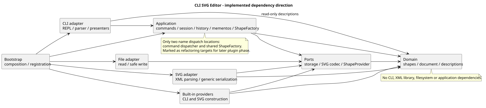
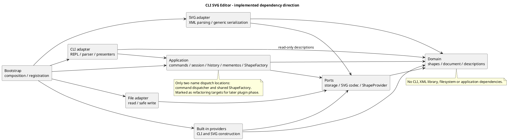

# 软件设计课程项目文档

版本 v1.3，2026-10-20，含历次整改及CLI显示修复（本次开发基线a5d1bb7）；增量见iteration-notes.md。课程 Phase 1 的代码、持续测试、独立系统验收和交付文档已完成。工作路线的阶段 1—9 是工程里程碑，区别于课程后续插件/GUI 阶段。本次用户明确暂不创建标签，截止日期未提供，不能宣称 final/截止时间要求已完成。

来源：[课程需求](../phase_cli_1.md)、[首次讨论](../think1.md)；授权：[agent.md](../agent.md)。实际规则见 [决策](decisions.md)，功能映射与结果见 [验收清单](acceptance.md) / [测试报告](test-report.md)。

## 架构方案

### 模块划分与依赖方向

工程根为 pj1/CLI_SVG_EDITOR；八个模块均已有实现，类各在同名文件，实例状态私有。

| 模块 | 实际职责 | 允许依赖及理由 |
| --- | --- | --- |
| domain | Shape/LeafShape 与六类图形、SvgDocument/ShapeTree、几何/样式/元数据校验、描述/复制、树不变量 | 仅自身；独立于入口与 IO |
| application | 19 命令、EditorSession 候选与发布、HistoryManager/Memento、Dispatcher/ShapeFactory、显示结果协议 | domain、ports、自身；用例通过协议使用外部能力 |
| ports | DocumentStorage、SvgCodec、ShapeCreator/Importer/Provider；冻结的 SvgElement、ImportedDocument、IdAssignment | domain、自身；协议不认识 Node 或 XML DOM |
| adapters/cli | Tokenizer、CliController、Repl、CliPresenter；提示符/错误及树线 | application、domain、自身、Node 终端；仅消费受控用例/描述 |
| adapters/svg | XmlSvgCodec：严格 XML/命名空间、候选补 id、通用序列化 | ports、domain、自身、运行时 XML 库；不依赖 application，不自建类型表 |
| adapters/files | NodeDocumentStorage/FileOperations：路径、UTF-8、临时文件/替换 | ports、自身、Node 文件/路径；不决定历史或领域规则 |
| adapters/shapes | 六类 Provider 和 BuiltinShapeProvider：自身参数、帮助语法与中立 SVG 构造 | ports、domain、自身；不持有全局会话 |
| bootstrap | EditorComposition 注册/注入，RuntimeEnvironment 与 main 入口 | 各生产模块及 Node；组装允许外层依赖内层，不包含图形算法 |

测试按 domain/application/adapters/integration/e2e/architecture/bootstrap 分层，fixtures 是可重复输入；doc 保存正式文档、图源/渲染、示例。node_modules/dist/artifacts/coverage 为忽略产物，不纳入课程源码。

以下 [PlantUML 图源](architecture.puml) 与内嵌文本一致，已用 PlantUML 1.2026.8/Smetana 实际渲染，并在浏览器检查完整图像：

Node 平台依赖和运行时 XML 包属于适配器/组装边界；依赖检查拒绝循环、未解析 import、生产代码导入测试/开发工具以及仅类型越界依赖。完整规则在 dependency-cruiser.config.json，不能以图上箭头替代真实检查。

### 设计模式与实际落点

| 模式 | 落点及作用 | 取舍 |
| --- | --- | --- |
| Command（必需） | Command/EditCommand 与各具体命令，统一 execute；编辑复用 EditorSession.edit | 每条编辑一个历史单元，复杂树操作不拆成多次可见撤销 |
| Composite | Shape/Group 的统一 move/scale/set、受控树删除；Group 对子孙多态 prepareTransform | 容器/叶子统一，不用标签判断操作；组样式只设置自身 |
| Memento | application 的 DocumentMemento/HistoryEntry 保存独立前后领域副本 | 完整复制 O(N)、历史 O(H×N)，精确恢复优先于复杂增量优化 |
| 工厂/提供者 | 同一 ShapeFactory 为 create 和 SVG 导入查找 Provider | 提供者各自构造/校验，没有第三套标签映射 |
| Adapter/依赖倒置 | 文件/XML/CLI 与内层协议分离；TreeDisplay/ShapeDisplay 多态调用 CommandFormatter | 替换外部实现不改变领域，显示不比较命令名/类型名 |

**两处待重构点：CommandDispatcher 命令名→实现、ShapeFactory 类型名→Provider。** 当前简单集中注册符合题目，后续插件阶段若获授权再调整注册来源和生命周期。clone、SVG 输出、tree/show 与图形几何不新增名字分派。输入语法/属性白名单/XML 根校验是边界验证，不承担第三套图形行为分派。

### 状态、原子性及 IO

SvgDocument 私有 ShapeTree 管理有序根/子节点及全局 id/父级索引，根 svg 不计入图形数。附着复制并检查整棵子树，重组通过受控操作维护无环/单父/顺序；front/back 不改身份与父级，仅重排同级。Group 几何先准备全部子孙、全部成功后应用，避免后方溢出留下部分修改。

编辑复制当前文档形成候选，Command 在候选执行并准备反馈；成功后再次复制发布文档与独立前/后 Memento，最后记录一个条目。失败保持文档、读入路径与两栈。undo/redo 先准备独立恢复副本，再迁移栈；redo 恢复保存的后状态，不重跑命令/工厂或访问文件。描述与值对象冻结，外部不获得持有节点。

read 在会话锁内解析路径、读文件、完整解析/校验及补 id，成功才一起发布文档、路径、警告和历史屏障。save 在锁内编码并准备反馈，同目录独占临时文件写入/flush/关闭/rename 成功后才建立屏障；失败不先删除旧目标。init 清除来源，显式另存不改变读入路径。查询不入栈；成功 init/read/save/canvas 修改清空旧历史并显式禁止 undo/redo，下一条成功编辑才解禁。

GeometrySummary 提供中立属性/点列；text/line 多态声明点，CLI 负责树线与 w/h 显示。PresentationAttributes/CanvasAttributes 保留受支持元数据，SVG 编码从完整描述输出，不把 XML 当作历史快照。支持范围和 local geometry 取舍见 [SVG/文件](svg-io.md)、[CLI](cli.md)。

### 变化点与暂定语义

| 可能变化 | 当前保留的边界或不预留的原因 |
| --- | --- |
| 插件类型/复合图形 | 共享 Provider/Factory、可容纳/可解散能力分离，data-kind 仅保存与普通g降级；尚未按标记恢复已注册类型、没有语义显示标注，便利属性反馈待重构。测试探针验证边界，不注册生产box |
| 新命令/其他入口 | Command 会话用例可复用，CLI 语法与显示隔离；应用编辑摘要目前为英语字符串，真正多语言时需中立富反馈 |
| XML 或存储策略 | SvgCodec/DocumentStorage 可替换；同步 IO 适合课程 REPL，未来异步须保持串行发布 |
| 大图与历史成本 | 具体 Memento 直接构造、已封装但没有可注入策略；完整副本/索引重建易验证，没有性能证据前不引入增量快照/裁剪/事件溯源 |
| 更广 SVG | 受控保留元数据，未知内容显式拒绝；不声明支持完整 CSS、路径、字体排版或世界坐标补偿 |

D03 跨父分组取共同父级/原前序/最早分支位置；D05 清除旧历史及无变化编辑入栈；D06 默认路径生命周期；D07 单尺寸参数；D10 未建文档 help 仍拒绝，均为未获教师确认的工程假设，可随补充要求修订。重组可能改变变换/继承后的视觉，未做补偿；明确需求仍以原文为准。

## 过程记录

详细早期讨论及每阶段真实检查快照保留在 [历史记录](historical-checks.md)，原文/首次讨论未改写。代表性讨论与修订如下：

| 阶段 | 实际发现/用户意见 | 修订与证据 |
| --- | --- | --- |
| 研究/设计 | SVG-Edit/Fabric.js/tldraw 提供编辑分层/注册/历史参考；读回与显示各自判断标签会违反要求 | 共享工厂与多态 describe/clone，不复制框架代码或引入它们作依赖 |
| 测试计划 | 用户指出原计划没有独立测试阶段 | 增加持续测试 + 阶段 8 系统回归，阶段 9 交付，建立 A/S 映射 |
| 工程基础 | 类型工具兼容性、依赖测试退出码与 Windows 缓存/进程限制 | 固定兼容工具，缓存 artifacts；实际权限允许后执行原测试，没有放宽类型或断言 |
| 领域 | 直接递归会在晚出现子孙溢出时留下部分修改；原型属性可能误入白名单 | Group 两阶段几何准备，自有属性校验，非法值与副本隔离测试 |
| 命令/历史 | 命令可能保留候选引用；移动摘要不能按标签分派 | 发布额外复制、Memento 独立；position 描述支持多态反馈，redo 不再调用工厂 |
| 树编辑 | 跨父 group 位置未定义、继承可能变化；深层测试把元素数误算 | 固定可修订 D03，原顺序/共同父级；修正测试计数，保留结构断言，两个真实提交检查点 |
| SVG/文件 | 背景含 transform/字体/viewBox，不能静默去掉；saxes 声明不兼容 strict TS | 受控保留并明确编辑语义；换 @rgrove/parse-xml，未启用 skipLibCheck；复制只在导入归一化 viewBox |
| 完整 CLI | 显示几何不能另建类型表；help 需真实完整语法 | GeometrySummary 和显示协议多态；帮助消费注册与 Provider 自身参数，回放完整 transcript/A |
| 系统回归 | 非法 QName 被 XML Name 验证漏过；read 的路径回调在锁外 | R01/R02 修复与复现测试同提交；真实 IO 失败继续 redo；阶段 8 为368项，交付补 R04 后376项完整回归通过 |
| 自动授权/交付 | 用户取消 add 清单确认，授权自动完成代码/测试/文档/commit/push；明确暂不创建标签 | 每阶段核对范围并提交推送；浏览器预览公开 HTTPS SVG；保留远程已有两次合并历史，标签不执行 |

首轮审查后清理旧屏障入口、补真实保存时机与源码规则反例、以测试容器明确已支持/待重构的扩展环节；具体文件及选择见 [增量记录](iteration-notes.md)。外部审查 skill v1.2 修正循环方向/help/证据口径，第一轮报告与日志保留。

第二轮审查确认上述整改后，开发跟进补上自定义标签导入的数据保持测试：输入节点区别于默认模板，逐项核验实际子树而非只统计提供者调用。纠正外部报告“未推送”的推断，真实远程默认与整改分支已包含审查基线；外部skill升级v1.3并附独立勘误，原两轮报告/脚本/日志保留。生产代码未改，开发跟进不冒充第三轮审查。

2026-10-20，第四轮复核后，用户确认修复tree同级列对齐和group单复数。先以新断言复现旧输出，再以通用描述计算每组列宽、按直接子节点数选择child/children；嵌套/局部树和历史摘要均有实际测试。完整检查415项通过，八套真实回放只存在允许的排版/文案差异；详情见增量记录，外部历史审查结论保持原样。

各阶段提交与结果见 [路线记录](roadmap.md)，最后系统报告在完成代码检查和浏览器观察后编写，不把计划当执行结果。

## 一致性自查

实际八模块与方案一致，85 个生产源码文件、77 个同名类、7 个接口及 main 入口。领域 24 类（原 21 加元数据与几何摘要），历史属于应用、IO 属适配器；所有预留目录已有实际实现。新增描述/协议均已写入方案，没有空 read/save 或第三套类型名映射。

实际生产依赖检查 91 模块/288 依赖、0 违规（含 XML 库模块）。抽查 EditorSession/ReadCommand/SaveCommand → ports/domain，XmlSvgCodec → ports/domain/parse-xml，NodeDocumentStorage → ports/Node，CliPresenter → application/domain，Provider → ports/domain；领域不依赖 Node/XML/应用，应用不依赖适配器。名字查找仅 Dispatcher.commands.get 和 ShapeFactory.providers.get，bootstrap 只登记名字。

SourceConventionChecker 同一扫描器检查生产源码及内存正/负例，补充隐式公开 readonly 参数属性、顶层函数变量、改名注册表和明显类型比较；结合人工抽样判断模式和名字分派，不声称 AST 已证明全部程序正确。图源/内嵌图一致，PlantUML 已渲染，真实例图与浏览器观察相符；最终链接/编码、Git 范围及远程核对见 [交付记录](delivery.md)。

## 质量保证手段

功能完整性以 A01—A29 / S01—S08 逐项映射检查，见 [真实测试报告](test-report.md)。六类图形与19命令有领域/应用/适配器/集成/真实进程证据；包括精确错误、失败状态不变、复杂结构恢复、屏障、redo 分支、自动 id、XML 转义/元数据及实际文件替换。图形与样式往返比较语义及属性存在性，撤销比较原值/结构，不用逆运算猜测恢复。

CLI显示修复后 npm run check 全部通过：strict 类型、0 警告 lint、生产构建、依赖方向、21 个测试文件/415 项测试、编译后组装。新增同级/嵌套/局部树/空容器/删除撤销重算对齐，以及单目标子树分组的计数、undo/redo和摘要验证。自定义标签导入的数据保持与失败状态测试继续通过；测试提供者不注册到生产。依赖固定且本次未变更，历史已按锁文件恢复；真实 CLI 测试独立编译当前源码。未设置虚构覆盖率、未将方法调用次数作为唯一正确性证据；未配置 CI 或声称跨平台已通过。

实际浏览器已预览 doc/examples 的流程图、典型会话和嵌套变换，并查看完整架构图。人工图像验证只覆盖样例，历史与边界仍由自动测试验证。已修复 R01/R02/R03/R04 的回归证据与支持范围公开；目前无阻断缺陷。大图性能、完整 SVG 格式、插件/GUI 仍非本课程阶段承诺。

分步 Git 历史已真实提交推送；A30 的 final 与截止时间按用户指示暂缓，不因业务通过自行创建标签。
