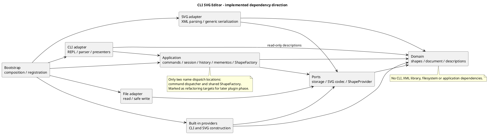

# 软件设计课程项目文档

版本：v0.7，2026-10-12；阶段 4 的 4e2bfbc 已推送，阶段 5 开发已授权并完成。分组/归属和删除/顺序/恢复两个单元均验证通过，本轮两个清单已确认并授权依次提交/推送；历史记录保留验证时的状态。

本文件是课程要求的主文档。架构内容区分实际实现与其余规划；过程记录只记实际发生的讨论；一致性与质量栏目区分设计检查和实现检查。当前已有领域、应用、提供者、CLI 和全部图形编辑，SVG IO 与完整显示仍待后续。

需求来源：[phase_cli_1.md](../phase_cli_1.md)。协作权限：[agent.md](../agent.md)。具体语义与验收分别见 [decisions.md](decisions.md) 和 [acceptance.md](acceptance.md)。

## 架构方案

### 1. 模块划分与职责

工程根目录是 `pj1/CLI_SVG_EDITOR`，不是整个课程目录 `SD`。本轮复用该目录下用户已有的空 Git 仓库，避免把其他课程项目纳入同一仓库。

以下模块目录已建立；domain、application、ports、CLI、图形提供者和 bootstrap 已有实际代码，SVG 与文件适配器仍是规划：

```text
src/
  domain/             # 图形、文档、树结构与值对象
  application/        # 会话、用例、Command、历史、共享图形工厂
  ports/              # 由内层使用的外部能力接口
  adapters/
    cli/              # REPL、分词、命令语法、展示
    svg/              # XML 与领域对象的转换
    files/            # 文件 IO
    shapes/           # 六种内置图形的提供者
  bootstrap/          # 具体对象组装与注册
tests/
  domain/
  application/
  adapters/
  integration/
  e2e/                # 真实 CLI 进程端到端测试
  architecture/       # 架构约束检查（或使用工具配置）
  bootstrap/          # 启动环境边界检查
  fixtures/           # 可提交的 SVG 和命令样例
doc/
  README.md           # 本文
  architecture.puml
  decisions.md
  acceptance.md
  testing.md
  roadmap.md
  development.md      # 实际工具链与工程检查入口
  domain-model.md     # 领域类职责、实际 API 与阶段 3 验证
  command-history.md  # Command、会话、历史与最小 CLI 的实际落点
  tree-editing.md     # 树编辑、重组位置、索引及恢复验证
```

| 模块 | 职责（SVG/文件仍为规划） | 明确不承担的职责 |
| --- | --- | --- |
| domain | `Shape` 抽象、五种叶子图形、`Group`、`SvgDocument`；校验属性及几何，维护树与 id 索引；多态复制和只读描述 | 不读文件、不打印、不认识 XML 库和 CLI token |
| application | `EditorSession`、具体编辑命令、文档用例、`HistoryManager`、`CommandDispatcher`、`ShapeFactory`；组织执行和状态提交 | 不直接使用终端或文件系统，不以图形类型分支实现几何操作 |
| ports | `DocumentStorage`、`SvgCodec`、`ShapeProvider`、工厂访问接口等必要协议 | 不包含 Node 文件操作或具体图形提供者注册 |
| adapters/cli | REPL、带引号信息的 token、命令语法、参数 schema 转换、错误/结果输出、tree/show/help | 不修改图形字段，不维护自己的历史 |
| adapters/svg | XML 解析、候选文档构建、通用 XML 序列化、导入警告收集 | 不自行建立标签到类的第三套映射 |
| adapters/files | 读取、临时文件与替换保存、路径错误映射 | 不决定 undo 是否允许 |
| adapters/shapes | `RectProvider` 等内置提供者；创建参数 schema、从参数/中立 SVG 描述构造领域对象 | 不保存全局文档，不含独立类型名分派 |
| bootstrap | 实例化依赖、注册六种提供者、注册命令、启动 CLI | 不承载图形算法或业务规则 |

一类一文件，类名与文件名一致。21 个领域类见 [domain-model.md](domain-model.md)；应用、协议、图形提供者和最小 CLI 的实际职责见 [command-history.md](command-history.md)。ports 当前只有 ShapeProvider/ShapeCreator，DocumentStorage/SvgCodec 等留在阶段 6 按实际需求确定，不以空接口冒充实现。

组件图箭头表示静态代码依赖。以下代码块与 [独立图源](architecture.puml) 保持一致；本轮未运行 PlantUML 渲染器。



### 2. 设计模式的选择及落地状态

| 模式/原则 | 实际或规划位置 | 解决的问题及取舍 |
| --- | --- | --- |
| Command（必需） | Command/EditCommand、Create/Move/Scale/Set 及阶段 5 Group/Ungroup/AddTo/Delete/Front/BackCommand 已实现 | 全部编辑整体一个撤销单元；具体命令只调用受控文档能力，候选执行和历史机制复用 |
| Composite（需求语义） | `Shape` 和容器能力；`Group` 的有序子树 | 命令统一对待容器和叶子，容器递归 move/scale，删除统一处理整棵子树 |
| Memento（当前选择） | application/DocumentMemento、HistoryEntry 已实现，封装领域复制 | 精确恢复坐标、样式缺省、父级及位置；第一阶段接受完整文档复制的空间成本 |
| 工厂与提供者 | 已有共享 ShapeFactory、ShapeProvider 与六种提供者；SVG 构造协议留阶段 6 | 当前 CLI 集中类型创建；未来读回扩充同一工厂，不另建标签映射 |
| Adapter / 依赖倒置 | 终端、SVG 和文件适配器实现内层协议 | 隔离 IO 和第三方库，允许替换入口与 XML 实现 |

不为展示或遍历再引入按类型名分派的 Visitor。图形已以多态 describe 产生中立只读描述：元素标签、明确设置的属性、文本和子节点；数据冻结，旧描述与模型变化独立。用于 CLI 展示的语义分组尚未添加，按实际展示需要再扩充。后续通用 SVG 序列化器据描述输出 XML；CLI presenter 据描述生成格式，不新增按类型名分支。描述不带终端树线或完整 XML 字符串，领域对象仍封装行为，而非退化成公共数据袋。

类型创建当前路径：CLI create 的中立参数经同一工厂交给提供者，提供者校验本类型参数数量及标量并创建领域对象。ShapeProvider 不依赖 CLI token 或 XML DOM。规划的 SVG 路径在阶段 6 扩充中立元素构造协议，仍复用同一工厂查找提供者；当前没有宣称已支持 SVG 创建或完整 schema。

**两处待重构点：** `CommandDispatcher` 的命令名注册/分发与 `ShapeFactory` 的类型名注册/分发，按需求 §2.1 明确标记为待重构。阶段一采用集中注册的简单实现；后续插件阶段调整注册来源和生命周期，不把类型判断散落到 parser、serializer、tree 或 clone。

### 3. 核心对象、结构及执行流程

`SvgDocument` 拥有画布并委托私有 `ShapeTree` 管理根级列表、id 及父级索引，提供受控的结构操作。根画布不是普通 `g`，没有可被编辑命令定位的图形 id。文档对外只提供 id 操作和不可变描述，不暴露持有节点；每个附着节点只有一个父级，图形树无环，索引与整棵树一致。

已实现插入/删除子树、group/ungroup/addTo、front/back：重组先完整校验，构造新组后才摘除节点，结构修改后重建索引；同级重排不改节点身份/父级，因此不重建这两个索引。OrderedChildren 一次准备新列表；Shape.canUngroup 与容器能力分开，不比较标签。树负责结构，不承担历史、路径、IO 或反馈；细节与暂定位置见 [树编辑记录](tree-editing.md)。

`EditorSession` 维护当前文档与默认保存路径；`HistoryManager` 管理历史与屏障；文件和 SVG 能力通过 ports 注入。历史对象不能混入领域快照。

编辑流程：

1. CLI 完成分词并保留引号信息，CommandRegistration 通用校验命令参数数量；不包含类型专用分支。
2. 应用入口校验文档状态，工厂/领域对象校验创建、几何、属性和结构约束。
3. 以当前文档的多态深复制建立候选状态，在候选状态执行 Command。
4. 执行成功后再复制发布文档，并准备独立的前/后快照；全部准备成功后才生成一个历史条目并发布文档。失败不改路径、历史或 id 分配；命令保留候选引用也不能随后修改会话。
5. 具体命令返回 CommandResult，当前封装应用反馈和撤销措辞；CLI 增加提示符/错误前缀并写终端。查询不进入历史。富反馈及完整 tree/show presenter 留后续按实际需要扩充，取舍见命令记录。

快照深复制保留具体子类型、属性“未设置”状态和有序结构；父级及索引指向新对象。undo/redo 发布独立的恢复副本，历史快照不得共享可写节点。重做恢复已保存的后状态，不重新读文件或重新分配 id；后续入口只以 id 寻址，不缓存跨恢复的可写图形引用。

预计每次编辑复制成本为 O(N)，历史空间为 O(H × N)，其中 N 是图形数、H 是历史条目数。本阶段没有自动裁剪历史的需求，不擅自增加可能丢失撤销能力的数量上限。

已实现 replaceDocument 和 establishIoBarrier 作为未来 read/save 的成功发布边界，实际 IO 尚未实现。规划 read 先完成读文件、解析、补 id 和校验，再一次替换会话并建立屏障，警告也在成功后输出；save 完成序列化和文件替换后才改变历史，另存不改读入路径。同步候选期间禁止重入会话修改；阶段 6 异步命令需继续串行执行。

### 4. 依赖方向规则

| 使用方 | 允许依赖 | 理由 |
| --- | --- | --- |
| domain | domain 内部及语言标准能力 | 领域规则可独立验证，不绑定基础设施 |
| ports | domain 的公开抽象与中立值对象 | IO 协议可以接收文档或工厂能力，不引入适配器类型 |
| application | domain、ports、application 内部 | 应用组织业务，通过接口访问外部能力 |
| adapters/cli | application、必要的 domain 只读描述 | 获取用例与展示数据；不能越过应用直接编辑文档 |
| adapters/svg、adapters/shapes | ports、domain、各自模块内部 | 实现协议；SVG reader 使用注入的工厂接口，不依赖工厂具体类 |
| adapters/files | ports、运行平台的文件能力 | 封装 IO |
| bootstrap | 上述模块的公开入口 | 唯一集中组装具体实现的地方 |
| tests | 被测模块及其测试协作对象 | 测试不能成为生产代码依赖 |

禁止：domain → application/ports/adapters；application → adapters/bootstrap；ports → application 的具体类；适配器横向互相导入具体类；生产代码 → tests；循环依赖。第三方 XML 库只出现在 SVG 适配器，终端与文件平台能力只出现在对应适配器和启动入口。

阶段 2 使用 TypeScript strict、ESLint 和 dependency-cruiser 检查实际依赖，包括类型 import。规则和工程测试已配置，详见 [开发说明](development.md)；工具不能代替模式及封装审查。违反依赖规则时登记待处理项并修正，不能仅通过修改架构图掩盖无理由的越界。

### 5. 变化点假设

| 变化点 | 当前预留 | 当前不实现与原因 |
| --- | --- | --- |
| GUI / 智能体入口 | 结构化应用调用、id 寻址、CLI 输出隔离 | 不引入 GUI/HTTP 框架，当前没有该入口需求 |
| box 及新图形类型 | 提供者、容器能力、多态描述/复制、共享工厂 | 不注册 box，不建立插件加载器；课程阶段边界明确 |
| 插件读回/降级 | 同一工厂可处理类型及中立扩展标记，普通 g 可保留 data-kind | 不实现插件生命周期；未来复合类型不能要求修改现有编辑命令 |
| SVG 支持范围扩大 | 编解码协议、显式导入范围、失败原子性 | 不承诺全 SVG/CSS/路径支持；复杂变换需要独立决策 |
| 撤销性能 | Command 意图与历史快照分离 | 不做增量快照/事件溯源，先验证精确恢复 |
| 存储能力 | storage 接口 | 不实现云端存储、数据库或自动保存 |
| 显示格式 | 通用只读描述与 presenter | 不让 domain 返回终端文本，不引入通用 UI 框架 |

未来 `box` 的设计推演：提供者构造一棵受其约束的子树，box 自身实现属性传播、多态复制和描述，并能表明“允许容纳子节点但不允许 ungroup”。容器资格不靠命令比较类型名判断。当前未注册 box 或实现其专属逻辑，已落地通用容纳/解散能力及拒绝分支；data-kind 识别/降级和序列化仍是未来方案。

### 6. 需求决策

[decisions.md](decisions.md) 逐项区分：题目明文、工程暂定规则、待教师/用户确认。跨父级 group、历史生命周期等已形成可修改的工程基线；transform/viewBox 和扩展导入范围仍开放，不在这里冒充已获确认。

## 过程记录

| 日期/阶段 | 实际讨论或发现 | 修订与依据 |
| --- | --- | --- |
| 2026-10-11 / 初次阅读 | 用户要求仅分析；提出领域、应用、适配器边界及 Command + Memento | 原讨论见 think1.md，未编写业务代码 |
| 2026-10-11 / 参考研究 | 查阅 SVG-Edit、Fabric.js、tldraw 官方说明；发现创建工厂不足以覆盖读回与展示 | 统一 CLI 与 SVG 创建入口，复制和输出通过多态，防止第三处分派 |
| 2026-10-11 / 需求复核 | 默认样式与未设置属性不同，group 可能改变继承；引号和 in 尾缀不能按字符串搜索判断 | 保留属性存在性；分词保留引号标记，追加相关验收场景 |
| 2026-10-11 / 阶段 1 | 用户提供仓库地址并授权阶段文档及初始化；发现本地工程已经有 .git、main 和正确 origin | 复用已有仓库，未执行重新初始化、commit/push/tag；read-only 远程引用查询因网络错误未成功 |
| 2026-10-11 / 阶段 1 | 需求存在未定义的分组位置、历史清除和外部 SVG 范围 | 建立决策记录和验收映射，区分工程假设与教师确认 |
| 2026-10-11 / v0.2 测试计划修订 | 用户指出测试分散在各阶段，缺少独立任务，并认可“持续测试 + 独立系统测试” | 增加 testing.md，阶段 8 专门测试与回归验收，交付顺延至阶段 9；同步准入/退出条件与报告要求，尚未执行业务测试 |
| 2026-10-11 / v0.3 提交规范 | 用户确认提交信息样式，指定任务分支为类型加描述，并要求每次展示 add 清单后等待确认；本次 14 文件清单已获确认 | 记录格式与确认门槛，允许本次文档提交及 push；阶段 2 变更另行列清单，不自动提交。已成功只读查询 origin，推送前无远程引用 |
| 2026-10-11 / 文档提交 | 用户明确确认此次可以提交并要求提交后初始化 | 36c2055 已推送至 docs-architecture-and-testing-plan；在 chore-typescript-tooling 开展工程基础，不沿用文档清单授权提交新变更 |
| 2026-10-11 / v0.4 工程基础 | 实际 npm 元数据表明类型检查插件尚不支持最新 TypeScript 7 | 锁定兼容的 TypeScript 6.0.3 与其余工具；建立严格配置、分层目录及真实依赖规则测试，不提前实现图形功能 |
| 2026-10-11 / v0.5 领域模型 | 用户授权推送工程基础并开始阶段 3；发现直接递归修改会在后续子孙溢出时留下部分状态 | 6a60d87 已推送；Group 两阶段准备/应用保证整组几何失败不变，ShapeTree 持有索引并隔离外部可写来源；本轮未提交 |
| 2026-10-11 / 领域复核 | 属性映射需防止原型链继承名被误当作白名单；只验证 CLI 错误将漏掉领域值错误 | 显式检查自有属性，增加 constructor/toString/__proto__、非有限数、尺寸与完整数字 token 的行为用例 |
| 2026-10-11 / 测试运行环境 | 默认 Windows 沙箱临时目录出现 Vitest 缓存文件缺失，两个测试套件未能执行 | 核对工具配置，把模块缓存放 artifacts/vitest-cache；默认命令和完整检查通过，未修改系统配置或放宽断言 |
| 2026-10-11 / 领域提交 | 用户确认 37 项变更并明确要求 commit/push | 6bd9a43 已推送 feature-domain-model；该一次性授权不适用于后续提交 |
| 2026-10-12 / v0.6 编辑流程与历史 | 用户提出进入阶段 4；核对需求中的失败不变、IO 屏障及最小 CLI 路线 | 实现 Command/Memento、会话、前/后候选发布、工厂/提供者和最小 REPL；新增应用、解析、集成及真实进程验证；提交仍须新清单确认 |
| 2026-10-12 / 快照与反馈复核 | 命令可能保留候选引用；按标签拼移动反馈会形成额外类型分派 | 发布时复制，历史恢复也复制；ShapeDescription 以多态提供中立 position，叶子反馈使用锚点、容器使用增量 |
| 2026-10-12 / 执行环境限制 | Vitest 启动时子进程被沙箱以 spawn EPERM 阻止，尚未运行用例 | 在获准的本地执行权限下重跑，持续测试及完整检查通过；没有放宽断言或修改系统设置 |
| 2026-10-12 / 提交确认 | 用户在收到 68 项清单、分支和提交信息后要求提交 | 本轮授权本地 commit；push/tag 仍按明确授权执行，不进入阶段 5 |
| 2026-10-12 / 阶段 4 推送 | 用户随后明确要求推送 | 4e2bfbc 已推送 feature-command-history，工作区与远程同步；不沿用该次权限提交阶段 5 |
| 2026-10-12 / 阶段 5 单元 A | 用户授权树编辑；跨父级 group 的位置与继承变化需要明确，构造新组可能失败 | 按暂定 D03 排序/最低共同容器，先构造/复制和检查未选 id 冲突再摘除；解散能力独立；按路线保留两次提交检查点 |
| 2026-10-12 / 分组测试复核 | 测试把深层场景的原 9 个元素加新组误记成 11 | 修正为修改前 9、修改后 10，保留完整结构/父级断言；随后完整检查通过 |
| 2026-10-12 / 阶段 5 单元 B | 需要验证整棵子树删除、边界重排和多条组合命令的恢复 | Delete/Front/BackCommand 复用候选/快照；新增六种删除、S03、逐步完整恢复与实际回放；A 检查点不被 B 覆盖 |

参考只用于设计，未复制代码或添加框架依赖：

- [SVG-Edit 官方仓库](https://github.com/SVG-Edit/svgedit)：编辑内核与 UI 的分离。
- [Fabric.js 对象扩展](https://www.fabricjs.com/docs/using-custom-properties/)：序列化与恢复类型的注册。
- [tldraw Editor](https://tldraw.dev/docs/editor)：批量修改与历史单元。

修订记录从本基线开始追加；如后续实现与本方案不一致，记录原因、影响及验证依据，不覆盖历史讨论。

## 一致性自查

### 1. 模块划分

实际模块目录与方案一致；领域仍为 21 个类，树编辑扩充受控方法；六个树命令各在同名文件，生产类共 61 个。Memento 属应用，树操作继续复用 EditCommand 的候选/历史入口。ports 当前只有创建协议，SVG/文件仍是规划目录；没有占位 read/save 实现。新增四个树编辑测试文件和两个真实 fixture，既有回归保留。

后续检查：实际目录是否对应模块；是否存在无明确职责的模块；是否通过公共数据袋绕过领域封装；类是否一类一文件；变化已记入修订记录。

### 2. 依赖方向

最终 66 模块、201 依赖检查通过，无循环或越界，包括仅类型 import。抽样核对六个树命令 → EditCommand/SvgDocument、ShapeTree → Group/ValueValidation：新建普通 g 是具体领域用例，不是类型名分派。领域无 Node/XML，应用无适配器，CLI 不直接修改节点；名字查找仍仅在 Dispatcher/Factory。单元 A 的独立依赖检查另保留为历史检查点。

当前文档检查结果：架构图与规则表的依赖方向一致；两处分派、源码目录规划和工厂入口一致。独立图源与内嵌图已进行文本一致性检查；PlantUML 图尚未渲染。

## 质量保证手段

### 1. 功能完整性

以 [acceptance.md](acceptance.md) 为索引，阶段 5 已补 A08、A12—A15、S03/S05 及全部编辑的 A18 历史粒度证据。真实 IO、完整 transcript 和系统验收未完成；S02 仍只验证 IO 屏障会话边界，不将部分结果标记为整套通过。

测试是明确的阶段任务：阶段 2 配置入口、阶段 3—7 持续验证，阶段 8 独立执行系统测试与回归验收，通过后才能进入阶段 9 最终交付。分层、必测范围、退出条件和报告要求见 [testing.md](testing.md)。阶段 8 覆盖 A01—A29，A30 的交付权限/远程/标签另在阶段 9 检查。

### 2. 代码质量依据（持续验证，完整系统验收待实施）

- 类型检查与静态检查：已配置 strict、ESLint 和依赖方向检查；封装及模式仍结合人工审查。
- 领域测试：几何变化、属性白名单、样式缺省、树不变量及 id 索引。
- 应用测试：每条命令历史粒度、redo 分支、屏障、失败原子性及精确恢复。
- 适配器测试：引号/颜色解析、规定输出、XML 转义、导入验证、文件失败与保存替换。
- 端到端：题目完整会话、流程图版本 A、保存再读入、box 拒绝；浏览器人工预览实际保存产物。
- 架构审查：真实依赖方向、两处分派位置、模式的类及调用路径与文档一致。

验证保持与变化相称，重点验证行为和边界，不为简单配置编写镜像测试。SVG 往返比较语义结构及属性存在性，不要求字节相同；浏览器预览不能替代历史和数据校验。

### 3. 本轮实际检查与限制

2026-10-11 初版 v0.1 的实际检查记录（以下数量是初版快照，测试计划修订另行检查）：

| 检查 | 结果 |
| --- | --- |
| 工程文件编码 | 13 个工程文件均为有效 UTF-8，不计 .git |
| 新编写文档的本地链接 | 25 个，缺失目标 0 个；来源讨论原文不改写 |
| 课程主文档栏目 | 架构方案、过程记录、一致性自查、质量保证手段均存在 |
| PlantUML 源 | 独立文件与内嵌代码块文本相同；未渲染 |
| 来源和规范副本 | phase_cli_1.md、think1.md、agent.md 与工程外对应文件逐字节一致 |
| 原需求与首次讨论 | 与本轮操作前 SHA-256 相同 |
| 验收映射 | 30 个条目，覆盖 19 个命令名；不是功能通过报告 |
| Git 状态 | 工程根目录正确；main 无提交；暂存文件 0、标签 0；origin 与用户地址一致 |
| 远程引用 | 查询失败：网络解析错误；未 fetch/push，不断言远程为空 |

未执行：业务测试、构建、类型检查、浏览器产物预览、PlantUML 渲染；相关实现/工具尚未建立。远程可达性检查失败，不能据此断言远程为空或已同步。截止时间未提供，final 标签还不具备执行条件。

### 4. v0.2 测试计划修订的文档检查

2026-10-11 已核对：14 个工程文件为有效 UTF-8；新编写文档的 32 个本地链接均有目标；路线编号连续为 0—9，阶段 8 是系统测试、阶段 9 是交付；30 个验收条目保留；课程需求和 think1.md 的 SHA-256 未变，Git 权限仍为禁止且暂存文件为 0。

本次只新增测试计划并同步相关说明，没有执行业务测试，也没有生成 doc/test-report.md。该报告待实现及实际测试完成后再编写。目录已整理为仅保留仓库内文件，协作入口同步移除了过时的双副本说明。

### 5. v0.4 工程基础初始化检查

2026-10-11 在 Node.js 24.11.0、npm 11.6.1 环境中执行。此处是工程基础验证，不是 SVG 功能验收报告。

| 检查 | 实际结果 |
| --- | --- |
| 项目依赖安装 | 成功生成锁文件；193 个包接受 npm 审计，当时报告 0 个已知漏洞 |
| 直接依赖完整性 | npm ls --depth=0 成功，7 项直接开发依赖与 package.json 精确版本一致 |
| 类型检查 | npm run typecheck 通过，覆盖源码、测试和 Vitest 配置，未跳过依赖类型 |
| 静态检查 | npm run lint 通过，警告为 0 |
| 构建 | npm run build 通过；dist 仅含 src 的编译结果及 source map |
| 真实生产依赖 | npm run check:architecture 通过，当前 2 个模块、1 条依赖，无违例 |
| 自动测试 | 2 个测试文件、37 个测试全部通过：9 个运行环境边界用例、28 个真实依赖检查样例 |
| 编译后启动 | npm run check:runtime 通过；输出工程就绪及 CLI 尚未实现的信息 |
| 完整入口 | npm run check 最终退出码 0；上述步骤顺序执行，任一失败即停止 |
| 文档与提交范围 | 42 个工程文件为有效 UTF-8，41 个本地文档链接目标存在；图源与内嵌图一致，两个来源原文未改动，临时样例已清理 |
| Git 提交边界 | 文档基线 36c2055 已推送；初始化位于 chore-typescript-tooling，尚未 add/commit/push，无新标签 |

第一轮架构回归发现测试辅助程序误把非 0/1 退出码当作执行异常。依赖检查器可能同时报告多个违例；已修正为检查退出码与诊断结果是否一致，随后完整检查通过。没有为让样例通过而放宽依赖规则。

工具链的通过只能证明当前工程入口与已测试的规则可运行。Command、Composite、图形语义、撤销、SVG 读写、CLI 输出等尚未实现，A01—A29 不据此标记通过；PlantUML 渲染及浏览器 SVG 预览仍未执行。下一工作单元为阶段 3 领域模型，需用户继续授权；本轮 35 文件清单已获确认，可进行本地提交。

### 6. v0.5 领域模型检查

2026-10-11，feature-domain-model 未提交工作区，Node.js 24.11.0 / npm 11.6.1；以下结果针对当前领域实现，不是阶段 8 系统报告。

| 检查 | 实际结果 |
| --- | --- |
| 范围 | 六种内置图形、画布、受控树/id 索引、几何/属性、不可变描述和多态深复制；未实现命令、历史、IO 或 REPL |
| 持续测试 | 3 个领域测试文件、81 个用例通过；覆盖正常/失败/嵌套行为、全局 id、对象/视图隔离及精确数值复制 |
| 完整回归 | npm run check 退出码 0，5 个测试文件、118 个用例通过（含原 37 个工程用例） |
| 类型/lint/构建 | 均通过，lint 警告 0；生产构建不包含 tests |
| 实际依赖 | 23 模块、55 依赖，无循环、未解析 import 或规则违例 |
| 设计模式/封装 | Composite 已落在 Group/Shape；复制和描述多态；类与文件同名，字段封装；没有新增按类型名分派 |
| 文档/源码范围 | 65 个工程文件为有效 UTF-8，56 个本地文档链接目标存在，图源与内嵌图一致；两个来源原文和依赖锁定未改动，暂存文件为 0 |
| 下一阶段 | 阶段 4 Command + 会话/候选执行/历史尚未授权；当前复制是 Memento 的基础，不是已完成历史 |
| Git | 工程基础 6a60d87 已推送至 chore-typescript-tooling；领域变更未 add/commit/push，无新标签 |

本轮错误输出、树结构和几何的领域检查与最终 CLI 检查分别记录。默认缓存目录故障在测试执行前发生，修复缓存位置后执行了完整回归；数值和树测试没有为通过而删除或放宽。源码审查与验收映射详见 [领域记录](domain-model.md) 和 [验收清单](acceptance.md)。

### 7. v0.6 命令与历史检查

2026-10-12，feature-command-history 未提交工作区，基于已推送的 6bd9a43；Node.js 24.11.0 / npm 11.6.1。以下为阶段 4 的持续验证，非阶段 8 系统报告。

| 检查 | 实际结果 |
| --- | --- |
| 范围 | Command、会话、候选执行、Memento/两栈/屏障、副本隔离、六种提供者及最小 REPL；未实现树编辑/真实 SVG IO/完整显示 |
| 完整回归 | 最后新增快照准备失败和真实 redo 分支用例后，npm run check 退出码 0；10 个测试文件、210 项全部通过 |
| 数量构成 | 原有领域 81 项、工程 37 项保留；新增应用/提供者/分词/集成/真实进程共 92 项 |
| 类型/lint/构建 | 全部通过，lint 警告 0，dist 只编译生产源码 |
| 真实依赖 | 60 模块、175 依赖检查通过，无循环、未解析 import 或规则违例；计数包含平台模块 |
| 真实 CLI | 编译当前源码至 artifacts/e2e-build；history.cli 输出、屏障与 redo、逐行提示符、错误后继续、CRLF/EOF 均通过 |
| 编译后组装 | npm run check:runtime 以 --check 检查对象组装并立即退出；默认入口正常启动 REPL |
| 设计审查 | 55 个生产类各在同名文件，字段封装；Memento 属应用；名字查找只在 CommandDispatcher/ShapeFactory，移动反馈消费多态 position |
| 文档及来源 | 98 个工程文件有效 UTF-8，79 个新编写文档本地链接目标存在；独立图源与内嵌图一致；课程需求、think1 内容和依赖锁文件未改动 |
| Git 边界 | 本轮 68 项变更：42 新增、17 修改、9 个已填充目录的占位文件删除；暂存为 0，未 commit/push/tag，仍待用户确认清单 |
| 剩余验证 | 复杂 group/delete 等整条恢复、真实 read/save、完整 transcript、浏览器 SVG 预览和独立系统验收留后续阶段 |

第一轮 Vitest 启动被沙箱子进程限制阻止；获准的本地执行权限下持续测试与完整检查通过。审查脚本按现有 Git 文本属性核对来源内容，think1 的原 CRLF 工作区副本未被改写。没有放宽断言、依赖规则或修改用户系统配置。阶段 5 尚未授权，本轮提交也不能沿用阶段 3 的一次性确认。

### 8. v0.7 树编辑检查

2026-10-12，feature-tree-editing 工作区，基于 4e2bfbc。按路线保留两个提交单元，不执行未经确认的 add/commit/push/tag。

单元 A（分组/归属）检查点：

| 检查 | 实际结果 |
| --- | --- |
| 范围 | group/ungroup/addto、受控列表替换、解散能力、相应历史及 CLI；删除/front/back 尚未加入 |
| 完整入口 | npm run check 退出码 0，类型/lint/构建/依赖/测试/组装均通过，lint 警告 0 |
| 测试 | 12 个文件、258 项通过；原 210 项保留，新增 48 项（领域 27、命令 20、真实进程 1） |
| 依赖/模式 | 63 模块、189 依赖，无违例；具体命令复用 EditCommand + 既有 Memento，解散判断无类型名分支 |
| 恢复与失败 | group/addto/ungroup 一个单元，完整父级/顺序/id/属性恢复，失败保留 redo/路径/屏障；分组复制失败无部分摘除 |
| CLI | 回放 tree-grouping.cli，精确错误与成功反馈通过，帮助自动包含已注册命令 |
| 下一单元 | 删除/front/back 与相应完整恢复，按本阶段授权继续；阶段 6 尚未授权 |

独立单元 A 的源码/文档快照和差异保留于忽略的 artifacts，供确认清单后只暂存该单元内容；这些准备不修改 Git 索引。完整系统报告、SVG 往返及浏览器预览仍未执行。

单元 B（删除/同级顺序/恢复）最终检查点：

| 检查 | 实际结果 |
| --- | --- |
| 范围 | 新增 delete/front/back，当前全部图形编辑已接通；SVG/read/save 和完整显示仍未实现 |
| 完整入口 | npm run check 退出码 0；类型/lint/构建/依赖/测试/组装均通过，lint 警告 0 |
| 测试 | 14 个文件、290 项通过；原 210 项保留，A 新增 48，B 新增 32（领域 9、命令 22、真实进程 1） |
| 依赖 | 66 模块、201 依赖，无违例；边界、规则及工具锁定未放宽 |
| 恢复 | 六种删除、嵌套子树、根级原位置、id 复用、同级顺序/边界和连续组合每一步完整恢复均通过 |
| 真实 CLI | tree-order.cli 的删除/恢复、前后顺序、嵌套移动及错误后继续通过；tree-grouping.cli 和既有回放保留 |
| 源码/文档审查 | 111 个工程文件有效 UTF-8，95 个新编写文档本地链接目标存在；61 个生产类各在同名文件，字段封装；图源与内嵌图一致，课程原文/think1 内容、package 和锁文件未改动 |
| Git 准备 | 基于 A 独立检查点保留 B 增量；两次清单可有共享文件，准备不等于暂存/提交 |
| 下一阶段 | 阶段 6 SVG 与文件尚未授权，D09 的开放支持范围仍需先定稿；系统报告和浏览器预览留后续 |

本阶段先完成并验证 A，再继续实现 B，实际检查分别记录；没有伪造分步提交或覆盖 A 的代码检查点。用户确认清单前不执行 Git 暂存。


## 2026-10-13 阶段 6 更新

SVG 与真实文件 IO 已实现；read/save 复用共享 ShapeFactory 与会话发布边界，严格失败原子性、补 id、路径、屏障和受控元数据往返。实际类、支持范围、依赖选择及验证见 [SVG 与文件说明](svg-io.md)。历史阶段的“尚未实现”是当时状态，以本更新为当前状态。用户授权自动完成剩余阶段并逐步提交推送，本次明确不创建标签。


## 2026-10-13 阶段 7 更新

全部 19 条命令接通：tree/show 按不可变描述及多态显示协议渲染，help 包含六类完整语法。新增 GeometrySummary 不含终端字符串，不增加类型名分派；查询及失败查询保持历史。课程 transcript 与版本 A 通过真实进程回放并读回保存产物。职责及实际样例见 [完整命令行](cli.md)，阶段 8 接续独立系统验收。


## 2026-10-13 阶段 8 完成记录

在 a4f84ae 的代码与测试上独立执行系统回归，20 文件/368 项测试通过，全部静态检查、真实 CLI 读写、源码范式和依赖检查通过。浏览器已预览三个实际 SVG 样例及完整架构图；A01—A29 与 S01—S08 的证据、缺陷和限制见 [验收报告](test-report.md)，本阶段完成。用户明确不创建标签，截止日期未提供；阶段 9 继续复核文档与远程。
