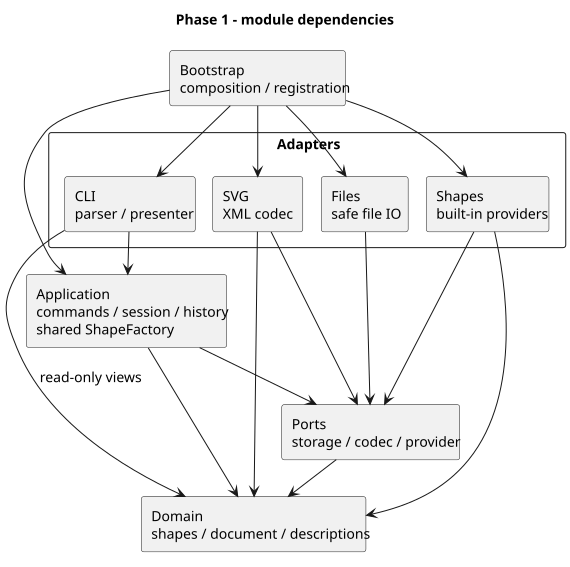

# 软件设计课程 Phase 1 项目报告

## 目录

- [软件设计课程 Phase 1 项目报告](#软件设计课程-phase-1-项目报告)
  - [目录](#目录)
  - [1. 项目认识与工作概况](#1-项目认识与工作概况)
  - [2. 架构方案与设计取舍](#2-架构方案与设计取舍)
    - [2.1 模块划分与依赖方向](#21-模块划分与依赖方向)
    - [2.2 图形模型与结构管理](#22-图形模型与结构管理)
    - [2.3 命令执行与撤销重做](#23-命令执行与撤销重做)
    - [2.4 文件读写与状态发布](#24-文件读写与状态发布)
    - [2.5 后续变化点与当前边界](#25-后续变化点与当前边界)
  - [3. 过程记录与 AI 协作中的思考](#3-过程记录与-ai-协作中的思考)
    - [3.1 先形成设计依据再进入实现](#31-先形成设计依据再进入实现)
    - [3.2 补上独立测试阶段](#32-补上独立测试阶段)
    - [3.3 重新检验扩展能力的证据](#33-重新检验扩展能力的证据)
    - [3.4 审查结论也需要复核](#34-审查结论也需要复核)
    - [3.5 筛选修改范围并保留过程记录](#35-筛选修改范围并保留过程记录)
  - [4. 一致性自查](#4-一致性自查)
  - [5. 质量保证手段](#5-质量保证手段)
  - [6. 阶段认识与后续计划](#6-阶段认识与后续计划)
  - [7. 项目资料与 GitHub 链接](#7-项目资料与-github-链接)

## 1. 项目认识与工作概况

本项目实现一个使用 TypeScript 编写的 SVG 命令行编辑器。Phase 1 包含六种内置图形、19 条命令，以及层级编辑、SVG 读写和撤销重做。本报告整理截至 2026 年 10 月 20 日的设计与迭代，代码及测试结果以提交 `04cc97e` 为基线。

开始时，我最关注的是后续迭代。题目已经给出了复合图形和插件化的方向，如果每个命令都直接操作 XML，或者分别根据标签决定行为，后续加入新类型时就需要在很多地方同时修改。因此，我先要求 AI 精读需求并讨论架构，暂缓业务实现，随后又要求调研相近项目、检查设计不足，并把重要约束写进项目规范。

在这个过程中，我逐步明确了自己的目标：让 CLI 成为编辑能力的一个入口，把图形规则、命令执行和外部文件处理分开。当前阶段先保证六类图形和既定命令完整可靠，后续再沿已有边界扩展。

课程建议使用 AI，我将其用于方案比较、代码实现、测试执行和文档整理。我负责提出关注点、追问设计依据、确认阶段范围，并根据测试和审查材料决定修改方向。架构经历了我的确认和调优，也借助 AI 完成了大量实现细节；报告中的设计选择和过程反思以这一协作事实为基础。

我的工作大致分为四个部分：

| 工作部分   | 主要内容                               | 我关注的问题                             |
| ---------- | -------------------------------------- | ---------------------------------------- |
| 需求与设计 | 阅读需求、调研参考、确定模块与测试路线 | 哪些是当前必须完成的，哪些只是后续目标   |
| 编辑内核   | 图形模型、树结构、命令与历史           | 修改是否受控，失败和撤销能否恢复完整状态 |
| 输入输出   | SVG 编解码、文件保存、CLI 显示         | 外部数据如何验证，读写是否影响编辑状态   |
| 复核与调整 | 系统回归、多轮审查、显示修复与记录     | 结论是否有证据，哪些建议值得进入修改范围 |

## 2. 架构方案与设计取舍

### 2.1 模块划分与依赖方向

我以职责和变化原因划分模块。图形几何和结构规则相对稳定，终端交互、XML 解析与文件操作更容易随环境变化，因此将这些职责隔离在不同位置。

| 模块              | 主要职责                                                 |
| ----------------- | -------------------------------------------------------- |
| `domain`          | 图形、画布、树结构、几何和样式规则、不可变描述与多态复制 |
| `application`     | 具体命令、编辑会话、历史与快照、命令分发和共享图形工厂   |
| `ports`           | 文件存储、SVG 编解码、图形创建与导入等协议               |
| `adapters/cli`    | 分词、REPL、错误反馈和结构树展示                         |
| `adapters/svg`    | XML 解析、SVG 校验、补 id 与通用序列化                   |
| `adapters/files`  | 路径处理、文件读取和临时文件替换                         |
| `adapters/shapes` | 六类内置图形提供者，负责参数和导入构造                   |
| `bootstrap`       | 注册内置能力、创建对象并连接各模块                       |

图 1 的箭头表示代码依赖；[PlantUML 图源](report-architecture.puml)与项目实现对应。`bootstrap` 负责连接具体实现，因此可以依赖各个外层模块。

我为内层确定了明确的限制：领域层只依赖自身；应用层依赖领域和协议，不解析 CLI 字符串，也不直接读写文件。SVG 和文件适配器实现外部能力，CLI 通过命令调用应用，并读取不可变的领域描述。

这样的划分让我能够具体判断一个功能应该放在哪里。例如，矩形宽度是否合法属于领域规则，文件路径如何解析属于文件适配器，输入参数是否完整属于 CLI 和命令构造边界。讨论实现时，我可以用这些职责检查 AI 给出的代码归属，减少随功能增加而产生的交叉依赖。

### 2.2 图形模型与结构管理

题目要求 TypeScript 面向对象实现，并限制按名字分派的位置。我据此采用 `Shape` 作为图形抽象，由叶子图形和 `Group` 分别实现自己的行为。命令调用统一操作，矩形调整自身坐标，线段调整两端点，容器递归处理子孙。

这里采用 Composite 的原因很直接：分组后的图形仍然需要移动、缩放、设置样式和删除。将容器作为同一图形体系中的对象，可以让命令保持统一，也为后续复合类型留下协作方式。

不过，几何操作与样式设置需要分别考虑。普通 `g` 的移动、缩放作用于子孙几何；设置 `g` 的 `fill` 则改变容器自身属性，由 SVG 的继承规则产生外观。若直接改写所有子节点的填充色，原有的显式样式就可能被覆盖。我在设计中保留了“没有设置属性”和“明确设置某个值”的区别。

结构关系由 `SvgDocument` 和 `ShapeTree` 统一管理。我关心的约束包括 id 唯一、单一父级、无环、子节点有序，以及树结构与索引一致。`group`、`addto` 和 `ungroup` 都通过受控入口完成，外部无法直接修改文档持有的子节点数组。

这种集中管理也帮助我识别题目中的决策空间。例如，跨父级分组需要确定新组放在哪里。当前选择最低共同容器，按原文档前序保持选中对象顺序，并放在最早相关分支的位置。我将其记录为工程选择，同时保留重组可能改变继承与变换后外观的限制。

### 2.3 命令执行与撤销重做

Command 是本项目的核心模式。每条命令由独立对象表达，编辑命令共用会话的执行流程，历史管理与具体输入语法分离。这样，复杂的分组和子树删除仍对应一个可见的撤销单元。

我选择 Command 与 Memento 配合，主要考虑恢复精度和结构完整性。缩放后再做除法可能留下浮点误差；删除后重新创建也容易遗漏父级、同级位置或样式缺省。保存编辑前后的领域快照，可以直接恢复原状态。

一次编辑的流程是：复制当前文档，在候选对象上执行命令并准备结果；全部成功后，准备独立的发布副本和前后快照，再记录一条历史。失败时保留原文档、来源路径和两栈。撤销恢复前状态，重做恢复后状态，重做过程中不重新运行工厂或文件操作。

我把完整复制的成本作为一个明确取舍。文档有 N 个节点、保留 H 条历史时，快照存储按 H×N 增长；一次编辑也需要遍历和复制文档。当前课程规模下，我优先选择容易检查的恢复方式。以后遇到真实的大图性能需求，再考虑子树快照、增量记录或历史裁剪。

历史屏障单独保存为状态。成功的 `init`、`read`、`save` 和画布尺寸修改会清空旧历史并禁用 undo/redo，下一次成功编辑重新解禁。查询不消耗历史，失败操作不能清空 redo。清除旧历史和无变化编辑入栈的细节已写入决策记录，便于后续根据补充要求调整。

### 2.4 文件读写与状态发布

我要求文件与 XML 处理都通过协议接入。应用只依赖 `DocumentStorage` 和 `SvgCodec`，由适配器处理实际文件系统和解析库。

读取时，先完整解析与校验候选文档，检查重复 id，再为缺 id 的元素补号。只有整份内容成功导入，才发布文档、路径和警告。这样，即使前面的节点合法、后面的节点失败，也不会出现当前文档被替换了一部分的情况。

保存时，在目标目录独占创建临时文件，完成写入、刷新、关闭和替换后，才建立历史屏障。已有目标文件不会先被删除。读取、保存及相关回调处于会话的同步执行锁内，以避免中途重入改变状态。

SVG 支持范围也作了明确选择：保存并读回六类图形和受支持的元数据，受控保留 `translate/scale`、字体及 viewBox 等信息；遇到不支持的内容显式报错。我认为，能够说明支持边界，有助于判断某次导入是否可靠，也能为以后扩大支持范围提供清晰起点。

### 2.5 后续变化点与当前边界

我曾要求 AI 调研 SVG-Edit、Fabric.js 和 tldraw 的相关设计。参考这些项目时，我重点比较编辑内核与入口的关系、图形注册，以及多个修改如何组成一次历史操作。项目没有直接引入这些框架，也没有复制它们的编辑语义；课程规定的缩放和历史规则仍需要由本项目落实。

最终保留的变化点如下：

| 变化方向           | 当前准备与尚未完成的部分                                                                                      |
| ------------------ | ------------------------------------------------------------------------------------------------------------- |
| 新图形与复合类型   | `ShapeProvider` 由共享工厂消费，创建与 SVG 导入使用同一查找；插件标记恢复、语义显示和便利属性反馈仍待后续完善 |
| GUI 或其他操作入口 | 可复用应用命令与会话；完整的多语言反馈仍需要进一步抽象                                                        |
| XML 或存储实现替换 | 通过编解码、存储协议隔离；未来异步 IO 需要继续保证串行发布                                                    |
| 大图与历史性能     | 快照实现集中封装；当前没有可注入的历史策略，按实际需求再重构                                                  |

`CommandDispatcher` 和 `ShapeFactory` 是现有的两处名字分派点，我在架构中将它们标记为后续待重构位置。注册来源和生命周期扩大后，需要重新设计这两处；复制、显示和序列化继续依靠多态描述，避免再建立类型表。

我也没有把预留接口等同于完成插件化。当前可以保存 `data-kind`，以普通 `g` 读回并保持结构和属性，但还不能凭该标记恢复已注册的插件子类型。`box` 属于后续阶段，当前按要求拒绝创建。这一边界使我能够控制 Phase 1 的范围，同时保留下一阶段需要解决的问题。

## 3. 过程记录与 AI 协作中的思考

### 3.1 先形成设计依据再进入实现

最初我要求只阅读和讨论，之后又要求寻找参考项目、检查设计不足，再进入初始化。这一安排给了我比较方案和提出约束的机会。例如，只有创建工厂还不足以覆盖图形扩展：如果读回、显示和快照各自判断标签，新增类型仍会影响很多内核位置。因此，经过讨论后，我确认创建和导入共用工厂，显示和复制通过多态实现。

我同时要求把关键规范写进 `agent.md`，保留原始需求、设计讨论和未明确事项。随着会话跨度变长，这些文件帮助我在继续工作时检查是否偏离原来的决定。文档中也需要区分题目明文、工程假设和当前实现，避免把讨论稿逐渐当成确定规格。

### 3.2 补上独立测试阶段

检查最初的工作计划时，我发现测试没有作为清晰的独立阶段展开，因此专门提出了这个问题，并要求调整文档。随后形成“开发中持续测试，加上实现后的系统测试与回归验收”的安排。

我认为这次调整很重要。分阶段的局部测试能够及时检查新功能，但读写、路径、分组、撤销和查询组合起来后，还需要验证跨模块状态。尤其在使用 AI 连续实现功能时，计划看起来完整，并不意味着验证工作的时间和退出条件已经安排清楚。

### 3.3 重新检验扩展能力的证据

在扩展性复核中，一个导入探针暴露出验证不足：它记录了提供者被调用，却在构造时使用默认子节点，输入中的子节点 id 被替换。调用成功只能说明路由可用，不能说明导入数据完整。

我要求将审查结论与已有代码对照，再确定修改计划。后续补充的测试提供者递归消费实际子元素，输入刻意使用不同于默认模板的 id、顺序和几何值，并检查文本、样式、空容器和父级。保存后读回普通 `g` 时，还分别检查数据保持和子类型能力降级。

这件事使我更重视验证条件的选择。测试应当能够区分正确实现和一种看似合理的错误实现；只检查“调用过”或“不抛异常”，很容易错过扩展链路中的数据丢失。以后再评估一个接口是否可扩展时，我会继续追踪它的完整使用过程。

### 3.4 审查结论也需要复核

另一处问题来自审查材料：报告看到历史交付分支仍停在旧提交，便判断后续修改尚未推送。实际核对真实远程引用后，默认分支和任务分支已经包含这些提交，历史分支只是保留当时的版本。

这个例子提醒我，增加一个 AI 审查环节，并不能省去对结论来源的检查。我需要确认它比较的是哪个分支、引用是否来自真实远程，以及证据是否足以支持判断。因此，后续将原报告保留，以单独勘误说明原因，并调整审查规则。

对代码的检查也采用类似思路：依赖规则和源码扫描器除了运行正常输入，还增加真实反例，检查违规时能否报告预期问题。同时保留静态检查的覆盖边界，不用扫描通过推断全部动态行为都已正确。

### 3.5 筛选修改范围并保留过程记录

审查给出显示差异后，我先要求整理简要清单，再决定修复范围。最终修正同级 `tree` 列对齐和单目标分组的英文单复数；保留显式 `stroke` 的展示和语义等价的 XML 属性顺序。未建文档时能否使用 `help` 仍单独记录为待确认项。

这种筛选帮助我控制迭代。需要修改的内容要有依据，暂时保留的差异也要有说明。树的排版使用统一的同级宽度规则，各层独立计算；我没有要求为每一行示例硬编码空格，也没有为了隐藏连线属性增加类型特判。

我对 Git 过程也作了明确要求：提交信息和分支采用统一格式，前期先查看暂存清单并确认，再允许提交。实现边界和工作规范逐渐稳定后，我授权自动完成后续代码、测试、记录与提交推送，但保留 final 标签的单独确认。

在较长的协作中，我持续提醒记录阶段结果和修改增量。我的目的在于让下一次审查能够知道修改了什么、依据是什么、哪些问题仍保留，而不必重新解释整个项目。记录也帮助我回看自己的决定：最初担心的扩展问题是否得到处理，后来的测试是否验证了这些设计。

## 4. 一致性自查

我将最终实现与原方案作了集中对照，详细过程保留在专题文档中。

| 自查项     | 当前结果                                                                                               |
| ---------- | ------------------------------------------------------------------------------------------------------ |
| 模块划分   | 实际为领域、应用、协议、四类适配器与组装层，职责与方案对应；新增的提供者、元数据和显示协议已同步记录   |
| 依赖方向   | 实际检查为 91 个模块、288 条依赖、0 条规则违规；领域和应用没有反向依赖终端、XML 或文件实现             |
| 模式与封装 | Command、Composite、Memento 均有实际落点；85 个生产源码文件中包含 77 个同名类和 7 个接口，另有启动入口 |
| 名字分派   | 集中在命令分发与共享图形工厂两处，已标注后续重构；显示、序列化和恢复没有额外图形类型表                 |
| 变化与取舍 | 跨父分组位置、快照成本、SVG 范围和历史屏障等选择有记录；实际边界与当前说明对应                         |

自查中我尤其关注“文档中的预留是否在代码里实际使用”。例如，存储和编解码协议确实被读写命令消费；历史快照虽然已经封装，但没有可注入策略。这些差别都保留在报告中。

## 5. 质量保证手段

我通过需求映射、自动化检查、真实 CLI 回放和审查复核共同判断完成程度。当前提交 `04cc97e` 的完整检查通过，结果为 21 个测试文件、415 项测试；严格类型、lint、构建、依赖约束和运行时组装检查也通过。

测试重点覆盖树结构与 id 不变量、复杂编辑的一次撤销、失败保留文档和 redo、文档操作的历史屏障、自动补 id、SVG 语义往返及真实文件写入失败保护。我更关注这些断言能否反映需求，而不将测试数量本身作为充分依据。

最近的显示修复还进行了八套真实 CLI 回放。允许差异仅为确认修改的排版空格与单复数，未发现其他输出变化；四份保存的 SVG 与修复前逐字节一致。补充用例检查了嵌套及局部树对齐、删除和撤销后重新计算列宽，以及单目标子树分组的计数和 undo/redo 摘要。

测试过程中的失败同样留有记录。例如，一次进程测试将新的空格数少算了一位，在核对实际规则后修正预期，并重新运行完整检查。历史阶段的 376、407、413 项结果保留为当时记录，与当前 415 项区分。

这些证据支持当前受控范围内的功能完整性。我没有据此声称所有 SVG 格式、跨平台行为或大图性能都已验证；最近一次文字修复也未重新做浏览器人工预览，原有样例预览保留为历史证据。

## 6. 阶段认识与后续计划

完成 Phase 1 后，我对 AI coding 中的职责有了更具体的认识。提出后续迭代要求，只是设计工作的开始；还需要把要求落实为依赖方向、对象职责、受控修改入口和可验证的恢复规则。AI 能较快给出实现，我仍需要检查这些实现是否持续满足已经确认的约束。

回顾这次工作，我认为自己的主要投入体现在三处：先确定架构和工作边界，再进入代码；在计划中补上独立测试阶段；面对审查材料时继续追问依据，并筛选值得修改的内容。图形模型、命令流程和文档在这一过程中一起调整，最终形成了可以继续讨论和修改的工程基础。

我也看到了当前协作方式的限制。若实现、测试和审查都依赖 AI，验证材料可能带有共同盲点；导入探针和远程分支判断就是具体例子。以后我会更早确定关键用例及失败状态的检查方式，并增加有针对性的手工场景核对，让自动化结果与自己的使用体验相互补充。

下一阶段若引入 `box` 或其他插件，我会优先处理类型注册、`data-kind` 读回、语义显示和便利属性反馈，检验新增类型究竟需要改动哪些内核位置。GUI 则应复用应用命令；历史性能优化需要先有实际数据，再选择更细粒度的快照方式。当前保留的 `help` 规则、示例显示差异和非 ASCII 标签终端宽度等事项，也将随验收口径或使用需求进一步处理。

截至本报告整理时，代码与测试已经推送，final 标签尚未创建。我会在最终确认提交版本和课程截止时间后完成提交标记。

## 7. 项目资料与 GitHub 链接

项目中的[工程主文档](README.md)保留完整架构、自查和过程索引；[设计决策](decisions.md)、[测试计划](testing.md)与[审查后增量](iteration-notes.md)记录具体依据。

GitHub 项目仓库：[Scoyn-X / CLI_SVG_EDITOR](https://github.com/Scoyn-X/CLI_SVG_EDITOR)
