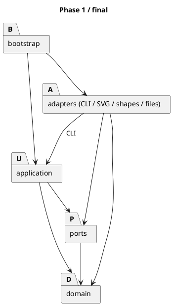
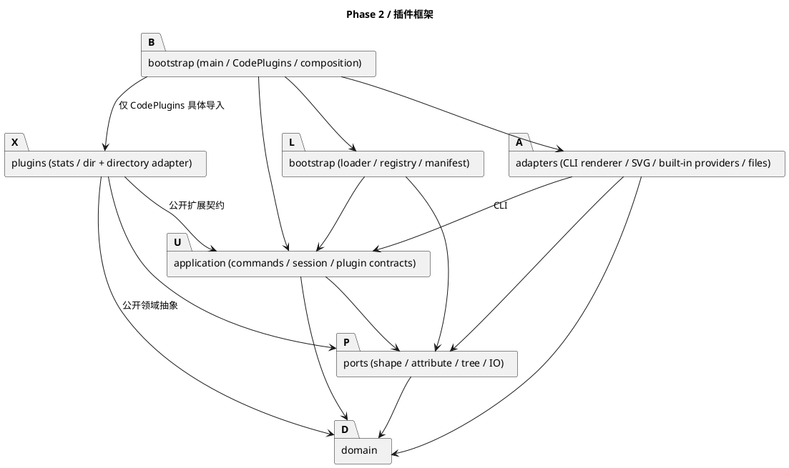

# Phase 2 CLI 框架与命令插件

为支持新增命令、图形类型和显示规则，CLI 将四类变化封装为扩展契约，通过统一的注册与加载流程接入插件。当前提供 stats 和 dir 命令，默认装配保留 Phase 1 的六种图形与 19 条命令。

## 运行与两种装配

在项目根目录运行：

```powershell
npm run build
node dist/bootstrap/main.js
node dist/bootstrap/main.js --code-plugins
node dist/bootstrap/main.js --config plugins.config.json
```

第一条启动命令只提供 Phase 1 能力。方式 A 的 `CodePlugins.load` 是唯一具体插件装配文件，依次装入 stats、dir。方式 B 的 `PluginLoader.loadConfig` 按配置顺序解析模块并加载插件。两者都进入 `PluginLoader.activate → PluginRegistry.install`，共用暂存注册、冲突检查、清单校验和提交路径。`main.ts` 只选择入口；`EditorComposition` 将已提交贡献注入工厂、命令分发表和显示器。

根配置示例：

```json
{
  "plugins": [
    { "module": "./dist/plugins/stats" },
    { "module": "./dist/plugins/dir", "enabled": true, "options": {} }
  ]
}
```

`plugins` 必须是数组，每项只接受非空 `module`、布尔 `enabled` 和任意 JSON `options`；省略 enabled 表示启用，false 完全跳过。配置顶层只接受 plugins。先验证整份结构再激活任何模块；文件不可读、JSON 或结构错误时报告 `error: invalid plugin config`，继续以默认能力启动。UTF-8 BOM 可读取。

相对路径以配置所在目录解析；支持带 `package.json/main` 的相对插件目录和具体 JS 文件。安装包按 Node 的 ESM import 条件解析，包括仅有 `exports.import` 的包。加载器用同步 `registerHooks` 临时设置解析父 URL，解析结束在 finally 注销，模块求值和激活期间没有残留 hook。Windows 绝对文件路径也可使用。模块默认导出应为有 `activate(context, options)` 方法的对象/类实例，不能只导出尚未实例化的类。options 原样传给该方法；现有两个命令插件不使用 options。

每个插件包独立声明 package.json，例如：

```json
{
  "name": "@svgframe/plugin-stats",
  "type": "module",
  "main": "./StatsPlugin.js",
  "contributes": { "commands": ["stats"] }
}
```

`contributes` 的 shapes、commands、decorators、attributes 为四类稳定注册名列表，缺省为空。形状注册名取 `ShapeProvider.getType()`；其余由注册方法显式传入。清单名称集合比较会排序，但调用顺序仍保留插件和注册顺序。清单不允许未知类别、空名称或重复名称。

## 扩展点清单

下表源码路径省略 `src/` 前缀。接口在内核侧，插件只依赖公开契约和公开领域抽象，依赖检查禁止内核反向导入插件。`PluginContext` 提供四种注册方法，`PluginModule` 描述激活协议。

| 接口与职责 | 实际调用位置 | 当前实现 | 禁用可选插件时 | 契约与失败处理 |
| --- | --- | --- | --- | --- |
| `ports/ShapeProvider`：创建、SVG 读回和帮助语法 | `application/ShapeFactory.create/fromSvg/getUsages`；`CreateCommand.apply` 使用创建结果 | `adapters/shapes/*Provider` 六类；测试 `MarkerProvider` | 六种内置类型仍注册；未知类型保留 Phase 1 错误 | 类型重名拒绝注册；provider 校验参数/子树，错误向 CLI 返回；创建/导入成功后才发布。自定义复合子类必须实现多态复制 |
| `application/Command` 抽象类及 `CommandRegistration`：命令执行、参数规则、帮助 | `CommandDispatcher.create` 查表并调用 `CommandRegistration.create`；`adapters/cli/CliController.executeLine` 调用 execute | 原 19 命令、`plugins/stats/StatsCommand`、`plugins/dir/DirCommand` | stats/dir 不在 help，执行报 `error: unknown command: <name>` | 重名拒绝注册；参数数目错误为 `error: usage: <usage>`；普通异常转成单行 unexpected command failure，下一条仍可执行。编辑命令须通过会话事务 |
| `ports/TreeDecorator`：逐树准备、逐行追加标签 | `adapters/cli/CliPresenter.tree` 调用 prepare，再在标题和 children 的每行调用回调 | 测试 `MarkerTreeDecorator` 及独立后缀探针；生产标签待做 | 空列表，不附加空格或标签，旧 tree 字节保持 | prepare 收到不可写的当前/干净描述；画布行 shape 为 undefined；空标签忽略。异常由控制器转单行错误，不发布部分树输出，不更改文档 |
| `ports/AttributeHandler`：属性匹配、受控修改及摘要 | `application/SetCommand.apply` 调用 handles/apply/summarize | 测试 `MarkerAttribute`；生产 box handler 待做 | 零命中，走原属性白名单 | 多重命中报 `error: conflicting attribute handlers: <attr>`；处理失败不再回退默认规则，丢弃候选文档并保留历史 |

测试专属实现位于 `tests/integration/PluginFramework.test.ts`，验证四类扩展的注册、调用和默认行为。生产插件的当前范围为 stats/dir；box 及两个树标签属于后续功能。

注册错误由加载器写 stderr，均以 `error:` 开头；交互命令错误沿用 Phase 1 的 stdout 诊断行为。

| 情况 | 诊断与继续行为 |
| --- | --- |
| 顶层模块找不到 | `error: plugin not found: <module>` |
| 无默认导出 | `error: plugin has no default export: <module>` |
| 清单不符 | `error: plugin manifest mismatch: <name> (declared: …, registered: …)`，内容为规范化的四类 JSON 集合 |
| 激活抛错，或模块求值/内部依赖失败 | `error: plugin failed to activate: <name> (<reason>)`；换行压成单行 |
| 同类名重复（包括内置名） | `error: duplicate registration: <category>/<name>` |

失败插件的全部暂存注册不提交，先前成功插件保持，后续继续装入。重复注册会锁定失败，即使插件捕获异常也不能提交它的其他贡献。激活完成后注册上下文封闭。回滚覆盖框架注册，不撤销插件自行进行的外部 IO。

## stats、dir 与适配器

`stats` 无参数，要求已 init/read。按当前有序子节点深度优先遍历；叶子按 `getType()` 统计，类型按首次出现排序；所有容器（含空容器）只计 containers，根 SVG 不计。空画布为 `(total 0, containers 0)`。它只读取描述，不写历史。

`dir` 无参数，未初始化文档也可用。只列当前进程工作目录直接子项，read/save 不改变该目录。顺序为目录、普通文件、其他项，各组按 JS 字符串大小关系升序，不依赖系统区域设置。显示 `[DIR]  name`、`[FILE]  name`、`[OTHER]  name`；隐藏项包含，`.`/`..` 排除。符号链接作为 OTHER，不跟随目标；名称中的 CR/LF 转义为可见字符。空目录为 `(empty directory)`；读取失败为 `error: cannot read directory: <path>`，之后仍能执行命令。

| 适配器角色 | 实际接口/类 | 职责 |
| --- | --- | --- |
| Client | `plugins/dir/DirCommand` | 请求工作目录、读取、排序和输出；不直接使用 Node fs |
| Target | `plugins/dir/DirectoryReader` | currentDirectory/read；返回中立的名称与类型 |
| Adapter | `plugins/dir/NodeDirectoryReader` | 把 cwd 和 Dirent 转成 Target 的结果 |
| Adaptee | Node `process.cwd`、`fs.readdirSync` | 提供真实进程路径与文件系统信息 |

`DirPlugin` 接受可替换的 DirectoryReader，默认使用 NodeDirectoryReader。A/B 激活同一个插件实例实现，使用同一接口。测试替身覆盖错误及特殊项；真实 CLI 测试使用固定临时目录，并将配置和日志放在被列目录之外。dir 成功、失败、参数错误都不改变文档、干净基准和 undo/redo。

## ADR

### P2-01：属性处理使用候选文档与单次提交（已实现）

handles 接收不可变 `ShapeDescription`，通过 getType、getChildren 等公开接口判断，不能更改活文档。apply 额外收到受控 set 回调，操作的是 `EditorSession.edit` 创建的候选文档；可以修改多个子件。零命中回原白名单；多命中直接拒绝，不采用不明确的覆盖顺序。apply 或 summarize 抛错均丢弃候选，历史和 redo 保持；成功发布独立副本并形成一个历史条目。可选 summarize 描述整个语义操作。代价是复制整份文档，处理器只能通过公开 set 修改既有节点。

### P2-02：语义类型与 SVG 标签分离，未知标记降级（框架已实现）

`Shape.getType()` 可与 SVG 标签不同。provider 必须显式声明 getSvgTag，且标签匹配时才消费 data-kind；否则按普通 SVG 标签 provider 读回。未安装对应插件的 g 保留 data-kind 和子树，降为普通 Group；不另造导入分派。复合子类通过 Group.createCopy 保留子类型，通过 canUngroup/canDetachChild 声明结构保护。完整子树附着时校验全局 id。生产 box 接入时须实现子件模板校验，并覆盖坏结构的拒绝策略。

### P2-03：注册暂存，激活后校验清单（已实现）

先建立插件独立的 PluginContributions，再执行 activate；结束后封闭上下文、按四类集合核对 manifest，全部成功才提交。A/B 共用此路径，防止代码装配绕过校验。重复名立即失败并记忆错误；失败贡献不泄漏，已成功插件不回滚。先解析顶层模块、再求值，区分模块缺失与内部依赖失败。代价是激活期不能直接看到其他插件的内部对象，也不支持启动后动态卸载。

### P2-04：干净基准与标签顺序（基准已实现，dirty 插件待实现）

会话在 init、成功 read/save 后保存不可变描述；失败 IO 不更新，canvas 调整不重置基准。tree 每次把当前描述和基准交给 prepare，按注册顺序追加各标签。后续 modified-star 拟按内容与基准不同判断：新节点立即标记、变化向祖先和画布传播、undo 回保存点清除；该变化集合应封装在插件实例，不使用模块变量。当前探针覆盖基准传递和多标签顺序；dirty 状态机随 modified-star 插件实现和验证。

## 重构前后依赖（PlantUML）

Phase 1 通过 Command 和 ShapeProvider 注册组织内置能力。Phase 2 在原有分层上增加统一的插件贡献注册，以及属性处理和树显示契约，使插件可以复用既有命令历史与 IO 边界。





L 按配置字符串动态装入模块，无具体插件静态依赖。Node 内置依赖仅用于装配、IO 适配器及 dir 的 NodeDirectoryReader。VS Code 为独立包，不进入 CLI 依赖图。自动依赖检查覆盖静态依赖，动态导入另以加载器测试和源码核查补充。

## 验证

框架验证覆盖三个方面：扩展契约的调用、插件加载的失败隔离，以及原有命令的兼容性。

| 测试入口 | 覆盖内容 |
| --- | --- |
| `tests/integration/PluginFramework.test.ts` | 自定义复合类型读回与复制、必要子件保护、属性事务、默认回退和多标签顺序 |
| `tests/bootstrap/PluginLoader.test.ts` | 四类加载失败、清单校验、重复注册及回滚、禁用、顺序、options 和 import-only 包 |
| `tests/application/CommandPlugins.test.ts` | stats 遍历和容器统计；dir 排序、隐藏项、空目录、读取失败、独立启停及历史保持 |
| `tests/e2e/CliHistory.test.ts` | 真实 CLI、固定工作目录、A/B stdout/stderr 字节一致和退出码、错误后继续运行 |
| `doc/transcript/phase1/replay.mjs` | 六组 Phase 1 冻结会话、原始输出、退出码、产物名称和四份 SVG 字节 |

`npm run check` 验证严格类型、lint、构建、依赖方向、全部测试及编译后组装。新增插件的接入记录按课程 A/B 变更边界核验实际提交：代码装配只修改一个组合根文件，配置装配通过新增插件和配置完成接入。

### AI 协作中的修正

为处理复合子类在历史恢复后丢失语义类型的问题，Group 通过 createCopy 让子类提供复制构造；探针验证分组与 undo/redo 后的类型和结构保护。属性处理采用候选文档，部分修改后抛错时整体丢弃，保留既有 redo。包加载的初稿只使用 require 解析，修订后按 ESM import 条件解析安装包，并以 import-only 入口和 hook 释放测试验证。
